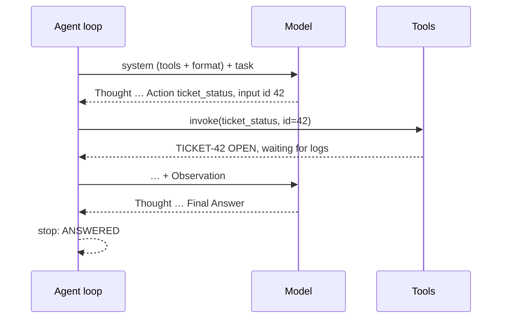

## Why it matters

Every agent framework hides the same loop. Writing it once — with its failure handling — makes every framework's configuration options obvious and every agent bug debuggable.

## Concept



The text protocol:

```text
Thought: <reasoning>
Action: <tool name>
Action Input: <JSON arguments>
```

or

```text
Thought: <reasoning>
Final Answer: <answer>
```

Native tool calling (Phase 6) replaces the text parsing with structured messages, but the loop, stopping rules and error handling are identical.

## Build it from scratch

The model is just a function from transcript to next message:

<!-- code: lessons/p10-agents/src/main/java/dev/aieng/p10/Llm.java -->

The loop, with four stopping conditions (answer, step limit, repeated action, budget) and format errors fed back as observations:

<!-- code: lessons/p10-agents/src/main/java/dev/aieng/p10/ReactAgent.java#loop -->

Tests drive it with scripted models:

- `reactLoopUsesToolsThenAnswers` — one tool call, then a final answer; checks the tool catalogue is in the system prompt and the observation is fed back.
- `modelMistakesBecomeObservationsNotCrashes` — a malformed reply becomes `ERROR: reply did not follow the required format.` and the model recovers.
- `loopsAndBudgetsStopTheAgent` — identical repeated actions stop with `REPEATED_ACTION`; ever-changing actions stop at `MAX_STEPS`; a tiny budget stops with `TOKEN_BUDGET`.

## Now with the library

To run against a real model, adapt `ChatClient` to the `Llm` interface:

```java
Llm llm = transcript -> chatClient.prompt()
        .messages(transcript.stream().map(m -> switch (m.role()) {
            case "system" -> (Message) new SystemMessage(m.content());
            case "assistant" -> new AssistantMessage(m.content());
            default -> new UserMessage(m.content());
        }).toList())
        .options(ChatOptions.builder().temperature(0.0).stopSequences(List.of("Observation:")))
        .call().content();
```

The `Observation:` stop sequence prevents the model from hallucinating its own tool results — a classic ReAct failure.

## Production notes

- **Record every step** (thought, action, arguments, observation, tokens, latency). It is your audit log and your debugging tool.
- **Truncate long observations** before adding them to the transcript; a tool returning 50 KB of JSON will blow the budget.
- **Temperature 0** for agent steps; creativity in tool selection is rarely wanted.
- **Native tool calling** is more reliable than text parsing with capable models — use it in production, keep ReAct for understanding and for models without tool support.

## Exercises

1. **Easy** — Add a `TIMEOUT` stop reason based on wall-clock time.
2. **Medium** — Truncate observations longer than 1,000 characters with a note `[truncated N chars]`, and test it.
3. **Hard** — Connect `ReactAgent` to a local model via the adapter above with two real tools (e.g. a calculator and a fake ticket API). Run 20 tasks and record answer accuracy, average steps and stop reasons.

## Common mistakes

- No step limit.
- Throwing exceptions from tools into the loop instead of returning observations.
- Letting the model write its own `Observation:` lines.

## Further reading

- Yao et al., "ReAct: Synergizing Reasoning and Acting in Language Models", ICLR 2023.
- Shinn et al., "Reflexion: Language Agents with Verbal Reinforcement Learning", NeurIPS 2023.
