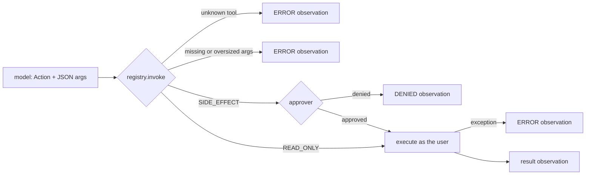

## Why it matters

Tools are where an agent touches the real world. The registry is the place to enforce what the model may do — and the place most agent incidents could have been prevented.

## Concept

Think of the registry as a **small `BeanFactory` with a security manager**: tools are registered by name with metadata, resolved at run time, and every invocation passes through validation and policy.

Design rules:

| Rule | Why |
|---|---|
| Task-level, narrow tools | `ticket_status(id)` is safe; `http_get(url)` is an exfiltration channel |
| Clear names, descriptions, parameter docs | Descriptions are the model's API documentation |
| Validate every argument | Model output is untrusted |
| Risk metadata (read vs write) | Different autonomy per risk class |
| Errors as observations | The model can recover; the loop does not crash |
| Run as the end user | Authorisation stays where it already works |
| Audit every call | Accountability and debugging |

## Build it from scratch

<!-- code: lessons/p10-agents/src/main/java/dev/aieng/p10/ToolRegistry.java#invoke -->

The tests check that unknown tools and missing parameters produce `ERROR` observations, and (`sideEffectsNeedApproval`) that a denied `close_ticket` call is **never executed** — the agent receives `DENIED…` and explains the outcome to the user instead.

## Now with the library

| Concept | Spring AI | LangChain4j |
|---|---|---|
| Tool definition | `@Tool(description=…)` + `@ToolParam` | `@Tool` + `@P` |
| Per-call context (user id, tenant) | `ToolContext` | `@ToolMemoryId`, invocation parameters |
| Return directly to user | `@Tool(returnDirect = true)` | — |
| Tool errors | `ToolExecutionExceptionProcessor` | Error handlers on AiServices |
| Approval | Your own wrapper / advisor before execution | Your own wrapper |

A common Spring pattern for approvals: write tools that create **pending actions** (a row in a table with a confirmation token) instead of acting; a separate, human-triggered endpoint executes them.

## Production notes

- **Version tool descriptions** with your prompts (Phase 7) — a description change changes agent behaviour.
- **Rate-limit and make writes idempotent** (idempotency keys), since agents retry.
- **Keep catalogues small** (5–15 tools per agent). Use routing (lesson 5) to pick the right specialised agent and toolset.

## Exercises

1. **Easy** — Add a `maxCallsPerRun` limit per tool and return `ERROR: limit reached` beyond it.
2. **Medium** — Implement the pending-action pattern: `close_ticket` returns a confirmation token and a description; a separate `confirm(token)` method executes it. Test that nothing executes before confirmation.
3. **Hard** — Add JSON-schema-like type validation (`int`, `enum`, regex) to `Tool` parameter definitions and generate the catalogue description from it.

## Common mistakes

- Generic tools that can do anything.
- Running tools with a service account that bypasses user permissions.
- Exceptions that abort the agent instead of informing it.

## Further reading

- OWASP Top 10 for LLM Applications 2025: LLM06 "Excessive Agency".
- Spring AI tool calling: <https://docs.spring.io/spring-ai/reference/api/tools.html>
