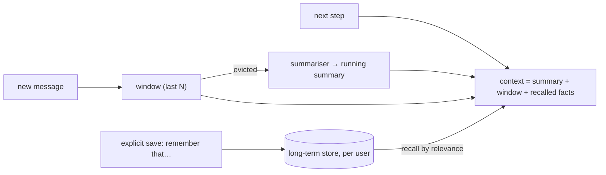

## Why it matters

Agents run for many steps; assistants serve users over many sessions. Without a memory strategy, context grows until it is too expensive, too slow, or too long for the model to use well — or the agent forgets crucial facts.

## Concept

| Tier | Holds | Lifetime | Mechanism |
|---|---|---|---|
| Working context | Current task transcript | One run | Window of recent messages |
| Summary | Compressed older turns | One run / session | Model call on eviction |
| Long-term | Facts, preferences, past outcomes | Across sessions | Store + retrieval (embeddings) |
| External state | Files, tickets, task records | Durable | Tools read and write it |

## Build it from scratch

Short-term window with summarisation:

<!-- code: lessons/p10-agents/src/main/java/dev/aieng/p10/Memory.java#shortterm -->

Long-term memory, scoped by user id:

<!-- code: lessons/p10-agents/src/main/java/dev/aieng/p10/Memory.java#longterm -->

The tests check that the third message evicts the first into a summary, and that recall never crosses users.

## Now with the library

- Spring AI: `MessageWindowChatMemory` + `ChatMemoryRepository` (JDBC, Cassandra, Neo4j…) for short-term; a `VectorStore` with a `userId` metadata filter for long-term recall; `VectorStoreChatMemoryAdvisor` retrieves relevant past messages instead of the latest ones.
- LangChain4j: `MessageWindowChatMemory`, `TokenWindowChatMemory`, and `ChatMemoryProvider` keyed by memory id.

## Production notes

- **Memory is personal data** — retention policies, encryption, user-visible "what I remember about you", deletion on request.
- **Guard memory writes** against injection: only save facts from the user's own messages, never instructions from retrieved documents or tool outputs.
- **Summaries lose detail.** Keep critical identifiers (ticket numbers, amounts) verbatim in structured state, not in prose summaries.

## Exercises

1. **Easy** — Change the window to 4 and show which messages are summarised after 6 additions.
2. **Medium** — Implement a token-based window using `ContextBudget.estimateTokens` from Phase 7.
3. **Hard** — Replace keyword recall with embeddings via a Spring AI `VectorStore`, using `userId` as a filter expression. Write a test proving another user's facts are never returned even when they are the closest vectors.

## Common mistakes

- Unbounded transcripts.
- Global, unscoped memory.
- Letting tool outputs write to long-term memory.

## Further reading

- Packer et al., "MemGPT: Towards LLMs as Operating Systems", 2023.
- Spring AI chat memory documentation.
