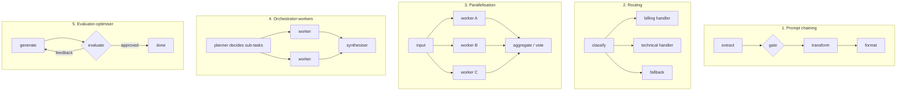

## Why it matters

Most production "agentic" systems are compositions of these five patterns. They are predictable, testable and cheaper than open-ended agents — and they combine: a router can send hard cases to an agent and easy cases to a single call.

## Concept



| Pattern | Use when | Watch out for |
|---|---|---|
| Chaining | Task decomposes into fixed steps | Error propagation — add gates |
| Routing | Inputs fall into distinct classes | Misrouting — have a fallback |
| Parallelisation | Independent sub-tasks, or voting | Cost multiplies |
| Orchestrator-workers | Sub-tasks unknown until run time | Unbounded plans — cap them |
| Evaluator-optimiser | Clear quality criteria, iterative improvement helps | Endless loops — cap rounds |

## Build it from scratch

Chaining with a gate:

<!-- code: lessons/p10-agents/src/main/java/dev/aieng/p10/Workflows.java#chain -->

Routing:

<!-- code: lessons/p10-agents/src/main/java/dev/aieng/p10/Workflows.java#route -->

Parallelisation on virtual threads:

<!-- code: lessons/p10-agents/src/main/java/dev/aieng/p10/Workflows.java#parallel -->

Orchestrator-workers with a capped plan:

<!-- code: lessons/p10-agents/src/main/java/dev/aieng/p10/Workflows.java#orchestrator -->

Evaluator-optimiser:

<!-- code: lessons/p10-agents/src/main/java/dev/aieng/p10/Workflows.java#evaluator -->

The test `workflowPatterns` exercises each one with plain lambdas standing in for model calls — including a planner that proposes four sub-tasks and is capped at two, and an optimiser that stops when the third draft is approved.

## Now with the library

In Spring, each lambda becomes a service method using `ChatClient`:

```java
enum Route { BILLING, TECHNICAL, OTHER }

Route route = classifier.prompt().user(ticket).call().entity(Route.class);   // structured output
String reply = switch (route) {
    case BILLING -> billingAssistant.draft(ticket);       // cheap model, billing prompt
    case TECHNICAL -> technicalRag.answer(ticket);        // RAG over product docs
    case OTHER -> humanQueue.enqueue(ticket);
};
```

For long-running, durable workflows with human tasks, use a workflow engine (Spring Batch, Temporal, Camunda/Flowable) and call LLMs from its activities — don't reinvent durability in memory.

## Production notes

- **Instrument every step** (latency, tokens, outcome) — workflows are easy to observe, so do it.
- **Timeouts per parallel branch,** with a defined result when one fails.
- **Cache classifier results** for identical inputs.

## Exercises

1. **Easy** — Add a timeout to `parallel` (`Future.get(timeout)`) and decide what the aggregate receives when a branch times out.
2. **Medium** — Implement routing for support tickets with a fake classifier and three handlers, including a confidence threshold that sends low-confidence cases to the fallback.
3. **Hard** — Rewrite `parallel` with Java's structured concurrency API (`StructuredTaskScope`, preview in recent JDKs) so that a failing branch cancels the others.

## Common mistakes

- Unbounded orchestrator plans and evaluator loops.
- Running dependent steps in parallel.
- Using an agent where routing would do.

## Further reading

- Anthropic, "Building effective agents" (2024) — the source of this taxonomy.
- JEP 505: Structured Concurrency.
