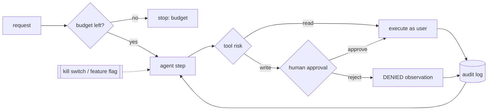

## Why it matters

Agents fail differently from ordinary software: confidently, creatively and sometimes expensively. Most incidents are preventable with a small set of controls designed in from the start.

## Concept: failure modes

| Failure | Example | Control |
|---|---|---|
| Wrong tool / wrong arguments | Closes ticket 24 instead of 42 | Validation, confirmations showing exact args |
| Looping | Calls the same search repeatedly | Loop detection, step limits |
| Runaway cost | 60 steps on a simple question | Token/cost budgets per run and per user |
| Hallucinated observations | Model invents a tool result | Stop sequences, native tool calling |
| Indirect prompt injection | Retrieved document instructs the agent | Data/instruction separation, approvals, narrow tools |
| Excessive agency | Agent can email anyone, pay anything | Least privilege, allow-lists |
| Silent partial failure | One tool failed, answer sounds complete | Explicit error observations, outcome checks |
| Goal drift | Long run forgets the original task | Re-state goal, summaries, shorter plans |

## Build it

The controls you have already built in this phase:

| Control | Where |
|---|---|
| Step limit, repeated-action detection, token budget | `ReactAgent.run` |
| Approval for side effects; errors as observations | `ToolRegistry.invoke` |
| Capped plans and refinement rounds | `Workflows.orchestrate`, `Workflows.refine` |
| Per-user memory scoping | `Memory.LongTerm` |

The remaining controls are operational: a **kill switch** (a feature flag that disables the agent or specific tools instantly), **per-user and global budgets** (Phase 14's rate limiter), **audit logs** of every step, and **staged rollout** (shadow → assisted → limited autonomy).

## Now with the library

- **Spring AI** offers tool-call limits on the tool-calling loop and `ToolContext` for passing the authenticated user into tools; approvals are implemented in your tool code or with a pending-action table.
- **Feature flags** (Spring Cloud Config, Unleash, LaunchDarkly, or a simple database flag) give you the kill switch.
- **Observability:** every step as a span with tool name, arguments hash, outcome and tokens (Phase 14).

## Production notes

- **Show users what the agent will do** before it does it — exact recipient, amount, record id.
- **Prefer reversible designs:** drafts, pending actions, soft deletes.
- **Review samples of successful runs too** — "successful" runs can still violate policy.
- **Re-run the agent eval suite** on every model, prompt or tool-description change.

## Exercises

1. **Easy** — List the tools of an agent you might build and assign each a risk level and approval policy.
2. **Medium** — Add a global `AtomicLong` token budget shared by all runs of `ReactAgent` and a test showing new runs refuse to start when it is exhausted.
3. **Hard** — Write a shadow-mode harness: run the agent on 20 historical tickets, record its proposed actions without executing them, and compare with what humans actually did. Report agreement per action type.

## Common mistakes

- Approvals that show "Approve agent action?" without details.
- Budgets per step but not per run or per user.
- No kill switch.

## Further reading

- OWASP Top 10 for LLM Applications 2025 (LLM01 Prompt Injection, LLM06 Excessive Agency).
- Greshake et al., "Not what you've signed up for: Compromising Real-World LLM-Integrated Applications with Indirect Prompt Injection", 2023.
