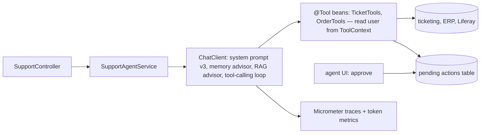

## Why it matters

You have built every piece of an agent by hand. In production you will assemble the same pieces from Spring AI, with Spring's security, configuration and observability around them.

## Concept: the mapping

| Hand-built (this phase) | Spring AI |
|---|---|
| `Llm` interface | `ChatModel` / `ChatClient` |
| `ToolRegistry.register` | `@Tool` methods on beans, `.defaultTools(...)` / `.tools(...)` |
| `ToolRegistry.invoke` validation | Your tool method (validate args, check permissions) |
| User identity in tools | `ToolContext` (`.toolContext(Map.of("userId", ...))`) |
| `ReactAgent` loop | Tool-calling loop (`ToolCallingAdvisor`) |
| Step limits | Tool-call limits on the loop |
| `Memory.ShortTerm` | `MessageWindowChatMemory` + `MessageChatMemoryAdvisor` |
| RAG tool / context | `RetrievalAugmentationAdvisor` (Phase 9) |
| Audit log | Observation API (Micrometer traces) + your own audit records |



## Build it

```java
@Component
class TicketTools {
    private final TicketService tickets;
    TicketTools(TicketService tickets) { this.tickets = tickets; }

    @Tool(description = "Status, assignee and last update of a support ticket")
    TicketView ticketStatus(@ToolParam(description = "Ticket id, e.g. 4711") long id, ToolContext ctx) {
        String userId = (String) ctx.getContext().get("userId");     // set by our code, not the model
        return tickets.viewAs(userId, id);                            // enforces the same permissions as the UI
    }

    @Tool(description = "Propose closing a ticket. Returns a confirmation token; nothing changes until a human confirms.")
    PendingAction proposeClose(long id, String reason, ToolContext ctx) {
        return tickets.proposeClose((String) ctx.getContext().get("userId"), id, reason);
    }
}

@Service
class SupportAgentService {
    private final ChatClient chat;

    SupportAgentService(ChatClient.Builder builder, TicketTools tools, ChatMemory memory,
                        @Value("classpath:/prompts/support-agent/v3.st") Resource systemPrompt) {
        this.chat = builder
                .defaultSystem(systemPrompt)
                .defaultTools(tools)
                .defaultAdvisors(MessageChatMemoryAdvisor.builder(memory).build())
                .defaultOptions(ChatOptions.builder().temperature(0.0).maxTokens(800))
                .build();
    }

    String handle(String userId, String conversationId, String message) {
        return chat.prompt()
                .user(message)
                .toolContext(Map.of("userId", userId))
                .advisors(a -> a.param(ChatMemory.CONVERSATION_ID, conversationId))
                .call()
                .content();
    }
}
```

Every element is something you built and tested earlier in this course: tools with approvals (lesson 3), memory (lesson 4), structured prompts (Phase 7), and the scripted-fake testing approach from Phase 6 — where `OrderTools` already proved the tool loop end to end.

## Multi-agent in Spring

Multi-agent systems are just several of these services: a **router** (Phase 10, lesson 5) chooses the specialist; an **orchestrator** service calls specialist services as tools; each specialist has its own prompt, tools and memory. Keep the contract between them typed (records via structured output), not free-form chat.

## Production notes

- **One agent, one purpose, small tool set.**
- **Identity from your security context only.** Never let the model provide user ids, tenant ids or roles.
- **Observability:** enable Spring AI observations; add custom spans for tool executions with outcome tags.
- **Evals per agent** on every change of model, prompt or tool descriptions (Phase 12).

## Exercises

1. **Easy** — Write the system prompt `support-agent/v3.st` for the service above, including approval behaviour.
2. **Medium** — Implement `TicketTools` against an in-memory `TicketService` and test `SupportAgentService` with a scripted fake model that calls `ticketStatus` then answers; assert the tool saw the right `userId`.
3. **Hard** — Add a second specialist (billing) and a router service using structured output; write an eval set of 20 tickets measuring routing accuracy.

## Common mistakes

- Model-supplied identities.
- One giant agent with every tool.
- No pending-action pattern for writes.

## Further reading

- Spring AI tools and ToolContext: <https://docs.spring.io/spring-ai/reference/api/tools.html>
- Spring AI observability: <https://docs.spring.io/spring-ai/reference/observability/index.html>
