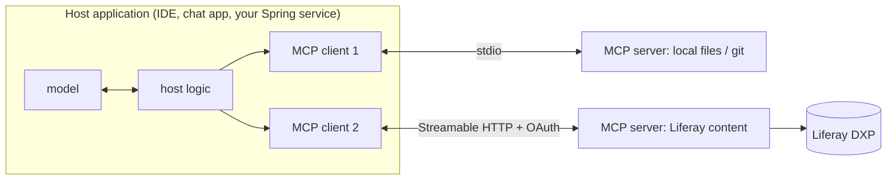

## Why it matters

Every AI application needs tools and data. Without a standard, each host (an IDE assistant, a chat app, your Spring service) writes its own connector for each system (GitHub, Jira, Liferay, a database): N × M integrations. The **Model Context Protocol** makes them N + M — like the Language Server Protocol did for editors.

## Concept

- **Host:** the application the user interacts with; it owns the model and decides what to expose.
- **Client:** one per server connection, inside the host.
- **Server:** exposes capabilities of one system.

### Primitives

| Primitive | Controlled by | Example |
|---|---|---|
| **Tools** | The model (invoked during reasoning) | `search_content(site, query)` |
| **Resources** | The application (attached as context) | `liferay://sites/intranet/pages/vpn` |
| **Prompts** | The user (selected templates) | "Summarise this site's changes" |

Clients can also offer capabilities to servers — **sampling** (server asks the host's model to generate), **roots** (filesystem scopes) and **elicitation** (server asks the user for input).

### Wire format

JSON-RPC 2.0 messages. A session starts with `initialize` (protocol version and capability negotiation), followed by the `notifications/initialized` notification; then `tools/list`, `tools/call`, `resources/read`, and so on.

### Transports

| Transport | How | Use |
|---|---|---|
| stdio | Host launches the server as a subprocess; newline-delimited JSON on stdin/stdout | Local tools, developer machines |
| Streamable HTTP | HTTP POST for requests, optional SSE streaming for responses | Remote, shared, multi-user servers with OAuth |

## Build it

Lesson 2 builds a server and a client from scratch over JSON-RPC; lesson 3 does it with Spring AI; lesson 4 exposes Liferay content; lesson 5 secures it.

## Production notes

- **An MCP server is an API product.** Version it, document its tools, monitor it, and secure it like any other API.
- **Hosts decide trust.** Installing an MCP server grants it influence over your model's context; review third-party servers like dependencies.
- **Prefer remote servers with OAuth** for enterprise systems, so identity and permissions are enforced centrally.

## Exercises

1. **Easy** — List three internal systems you would expose via MCP, and for each the tools, resources and prompts.
2. **Medium** — Read the MCP specification's lifecycle section and draw the message sequence for `initialize` → `tools/call`.
3. **Hard** — Write a one-page comparison: exposing your ticketing system as (a) Spring AI `@Tool`s inside one application vs (b) an MCP server used by several hosts. Consider ownership, security, versioning and latency.

## Common mistakes

- Treating MCP as a replacement for API design (tools still need careful, narrow design).
- Running untrusted local MCP servers with full user privileges.
- Exposing dozens of tools from one server to every host.

## Further reading

- MCP specification: <https://modelcontextprotocol.io/specification>
- MCP Java SDK: <https://github.com/modelcontextprotocol/java-sdk>
