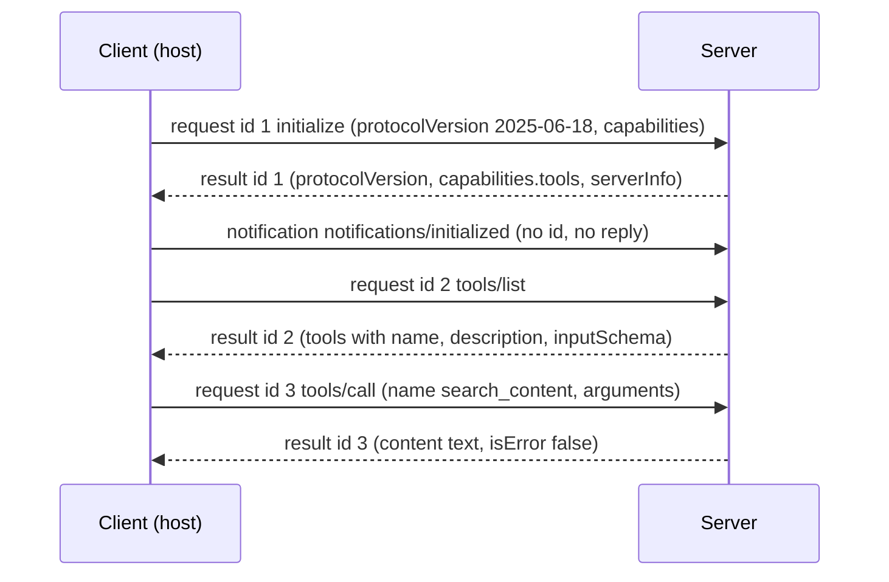

## Why it matters

Frameworks make MCP a few annotations, but when a connection fails in production you will be reading raw JSON-RPC. Building the protocol once makes those logs readable — and shows how little magic there is.

## Concept



Error semantics:

| Situation | Response |
|---|---|
| Invalid JSON | JSON-RPC error `-32700` (parse error) |
| Unknown method | `-32601` (method not found) |
| Unknown tool / bad params | `-32602` (invalid params) |
| Tool ran and failed (e.g. permission) | **Result** with `isError: true` |

## Build it from scratch

The dispatcher — notifications get no reply; tools require completed initialisation:

<!-- code: lessons/p11-mcp/src/main/java/dev/aieng/p11/McpServer.java#dispatch -->

Tools listing and invocation, including the result-vs-error distinction:

<!-- code: lessons/p11-mcp/src/main/java/dev/aieng/p11/McpServer.java#tools -->

The stdio transport — one JSON message per line; logs to stderr:

<!-- code: lessons/p11-mcp/src/main/java/dev/aieng/p11/McpServer.java#stdio -->

And the client side a host runs:

<!-- code: lessons/p11-mcp/src/main/java/dev/aieng/p11/McpClient.java#lifecycle -->

The tests connect client and server in memory and cover the full lifecycle, tool discovery with JSON schemas, `isError` results for permission failures and missing arguments, protocol errors for unknown tools/methods and bad JSON, version negotiation, and the stdio transport with a mix of requests and notifications.

## Now with the library

The official **MCP Java SDK** (`io.modelcontextprotocol.sdk:mcp`) implements this — plus resources, prompts, sampling, streaming HTTP and session management — and Spring AI builds its MCP starters on it (next lesson). Run the demo server from this lesson with any MCP host that supports stdio servers:

```json
{ "mcpServers": { "course-demo": {
    "command": "java",
    "args": ["-cp", "lessons/p11-mcp/target/classes:<jackson jars>", "dev.aieng.p11.McpServer"] } } }
```

## Production notes

- **Never print to stdout** in a stdio server except protocol messages.
- **Validate tool arguments** against the schema you published — models make mistakes.
- **Keep responses small:** tool results enter the model's context window.

## Exercises

1. **Easy** — Add `resources/list` returning one static resource and a test for it.
2. **Medium** — Add `notifications/tools/list_changed` support: when a tool is registered at run time, the server sends that notification and the client re-lists.
3. **Hard** — Implement a minimal Streamable HTTP transport for `McpServer` with the JDK `HttpServer`: POST a JSON-RPC message to `/mcp`, return the JSON response, and require an `Mcp-Session-Id` header after initialisation.

## Common mistakes

- Answering notifications.
- Using JSON-RPC errors for tool-level failures.
- Mixing logs into stdout.

## Further reading

- JSON-RPC 2.0 specification: <https://www.jsonrpc.org/specification>
- MCP specification, "Lifecycle", "Transports" and "Tools" sections.
