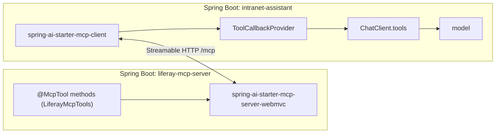

## Why it matters

Spring AI makes both sides of MCP a matter of a starter and a few annotations, so the interesting work stays where it belongs: tool design, security and operations.

## Concept



## Build it: the server

The annotated tools — compiled and kept in this phase's module:

<!-- code: lessons/p11-mcp/src/main/java/dev/aieng/p11/LiferayMcpTools.java#annotated -->

Server application:

```xml
<dependency>
    <groupId>org.springframework.ai</groupId>
    <artifactId>spring-ai-starter-mcp-server-webmvc</artifactId>
</dependency>
```

```java
@SpringBootApplication
class LiferayMcpServerApp {
    @Bean
    LiferayMcpTools liferayMcpTools(LiferayTools.ContentGateway gateway) { return new LiferayMcpTools(gateway); }
}
```

```yaml
spring:
  ai:
    mcp:
      server:
        name: liferay-mcp
        version: 1.0.0
        protocol: STREAMABLE          # Streamable HTTP transport
        instructions: "Read-only access to published Liferay web content."
```

The starter's annotation scanner finds `@McpTool` methods on beans and generates their JSON schemas from parameter types and `@McpToolParam` descriptions.

## Build it: the client

```yaml
spring:
  ai:
    mcp:
      client:
        streamable-http:
          connections:
            liferay:
              url: https://liferay-mcp.internal.example.com
```

```java
@Service
class IntranetAssistant {
    private final ChatClient chat;

    IntranetAssistant(ChatClient.Builder builder, ToolCallbackProvider mcpTools) {   // provided by the MCP client starter
        this.chat = builder
                .defaultSystem("Answer intranet questions. Use search_content, then get_content, and cite URLs.")
                .defaultToolCallbacks(mcpTools)
                .build();
    }

    String ask(String q) { return chat.prompt().user(q).call().content(); }
}
```

From the model's point of view, remote MCP tools and local `@Tool` methods are indistinguishable — both are `ToolCallback`s in the tool-calling loop from Phase 6.

## Production notes

- **Filter which remote tools a given ChatClient sees;** don't hand every tool of every server to every use case.
- **Timeouts:** configure `spring.ai.mcp.client.request-timeout`; remote tools add network latency to each agent step.
- **Version your server** (`version`, changelog of tool changes); tool description changes are behaviour changes for every host.
- **Contract-test the server** with the hand-built client from lesson 2 or the SDK client.

## Exercises

1. **Easy** — Add an `@McpResource` exposing a site's navigation as a resource with a `liferay://` URI.
2. **Medium** — Create the server application above with an in-memory `ContentGateway`, run it, and call it with the lesson-2 `McpClient` using `java.net.http.HttpClient` as the transport.
3. **Hard** — Build the client application and connect it to your server; with Ollama running a tool-capable model, ask "How do I configure the VPN proxy?" and trace the tool calls in the logs.

## Common mistakes

- Exposing all remote tools to every ChatClient.
- No timeouts on remote tool calls.
- Treating the MCP server as internal plumbing instead of a versioned API.

## Further reading

- Spring AI MCP overview: <https://docs.spring.io/spring-ai/reference/api/mcp/mcp-overview.html>
- Spring AI MCP server and client boot starters documentation.
