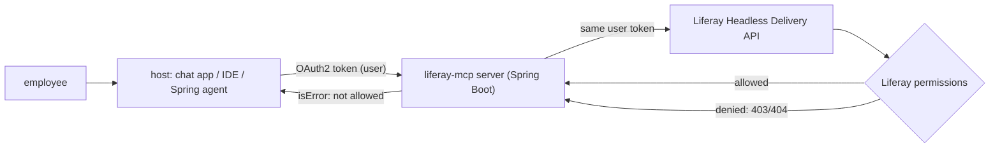

## Why it matters

A Liferay MCP server lets any MCP-capable host — an IDE assistant, a desktop chat app, your own agents — work with portal content through one governed interface instead of ad-hoc integrations. Designed badly, it becomes the easiest way to exfiltrate the intranet.

## Concept

### Capability design

| Capability | Type | Notes |
|---|---|---|
| `search_content(site, query, limit)` | Tool | Read-only; titles, URLs, short snippets |
| `get_content(id)` | Tool | Clean text, truncated; URL for the full page |
| `list_sites()` | Tool or resource | Only sites the user belongs to |
| `liferay://site/{key}/navigation` | Resource | Site structure for context |
| "Summarise recent changes on a site" | Prompt | User-selected workflow |
| `create_draft(...)` | Tool (later) | Draft only, separate scope, workflow review |

## Build it

The tool implementations over a `ContentGateway` (the Headless Delivery client from Phase 9 behind an interface):

<!-- code: lessons/p11-mcp/src/main/java/dev/aieng/p11/LiferayTools.java#tools -->

Key decisions visible in the code:

- **Schemas with limits** (`limit` 1–20, `additionalProperties: false`), and the handler clamps anyway — never trust that the client validated.
- **Compact text output** with ids and URLs, so the model can cite sources and call `get_content` next.
- **Permission failures surface as `isError` results** (the test `toolFailuresAreResultsAndProtocolFailuresAreErrors` checks that reading content 102 returns *not allowed*), so the model can tell the user instead of guessing.

## Identity flow

1. The host authenticates the user (SSO) and obtains an OAuth2 access token for the MCP server's audience.
2. The MCP server (a Spring Security resource server) validates the token and exchanges or forwards it to call Liferay as that user (Liferay supports OAuth 2.0 applications; token exchange or a shared IdP lets Liferay accept the identity).
3. Liferay evaluates permissions; the MCP server never caches content across users.

## Production notes

- **Read-only first.** Add writes only as drafts behind Liferay workflow.
- **Rate limits per user and per host,** and response size caps.
- **Audit:** host, user, tool, arguments (hashed if sensitive), result size, latency.
- **Sanitise content** (strip scripts/hidden text) to reduce indirect prompt-injection risk from portal pages (Phase 15).

## Exercises

1. **Easy** — Add a `list_sites` tool to `LiferayTools` backed by a new gateway method, with a test.
2. **Medium** — Truncate `get_content` output to 4,000 characters with a trailing note and the URL; test it.
3. **Hard** — Implement `ContentGateway` with `RestClient` against Liferay Headless Delivery (reusing Phase 9 code) and run the Spring AI MCP server from lesson 3 against a local Liferay (the official `liferay/portal` Docker image works for experiments).

## Common mistakes

- A service account with admin rights behind the MCP server.
- Generic "call any API" tools.
- Returning raw HTML with scripts and navigation.

## Further reading

- Liferay Headless Delivery API and OAuth 2.0 documentation (learn.liferay.com).
- MCP specification, "Authorization" section.
