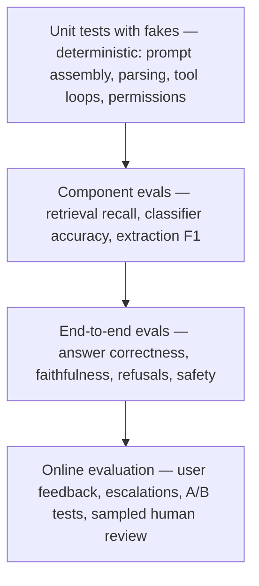

## Why it matters

In traditional software, correctness is binary and tests prove it. In AI features, quality is **a distribution over inputs**, and every prompt, model, retrieval or chunking change shifts it. Without evals you are guessing — and every "improvement" risks a silent regression elsewhere.

## Concept: testing layers

| Layer | Runs | Model | Example in this course |
|---|---|---|---|
| Unit | Every build | Fake | `ScriptedChatModel` tests (Phase 6) |
| Component | Every build or nightly | Real or deterministic | Retrieval recall of the course Tutor (lesson 6) |
| End-to-end | Nightly / pre-release | Real | `EvalRunner` with a judge |
| Online | Continuously | Production | Thumbs, escalations, sampled review |

**Eval-driven development** loop:

1. Collect real examples (inputs + expected outcomes or rubrics).
2. Run the current system; read the failures.
3. Change one thing (prompt, retrieval, model).
4. Re-run; keep the change only if the metric improves without regressions.
5. Add every production failure to the dataset.

## Build it

This phase builds the toolkit in plain Java:

| Lesson | Code |
|---|---|
| 2 — datasets and metrics | `RetrievalMetrics`, `TextMetrics` |
| 3 — LLM-as-judge | `LlmJudge` |
| 4 — RAG evaluation | `RagMetrics` |
| 5 — testing non-deterministic systems | Fakes, properties, statistical assertions |
| 6 — evals in CI | `EvalRunner` with thresholds, baselines and confidence intervals |

## Production notes

- **Start small:** 30–50 well-chosen examples beat 1,000 random ones on day one; grow the set from production.
- **Version datasets** with the code and record which dataset version produced each report.
- **Read failures, not just averages.** The single most useful activity in AI engineering is looking at bad outputs.

## Exercises

1. **Easy** — Write ten eval cases (input, expected outcome, category) for the course Tutor.
2. **Medium** — Define the Definition-of-Done thresholds you would require for that Tutor, with justifications.
3. **Hard** — Design an online feedback loop: how thumbs-down answers flow into a review queue and then into the eval dataset, including privacy handling.

## Common mistakes

- Shipping on "vibes" from a few manual tries.
- Only measuring averages.
- Never adding production failures to the eval set.

## Further reading

- Hamel Husain, "Your AI Product Needs Evals" (2024).
- Shreya Shankar et al., "Who Validates the Validators?", 2024.
