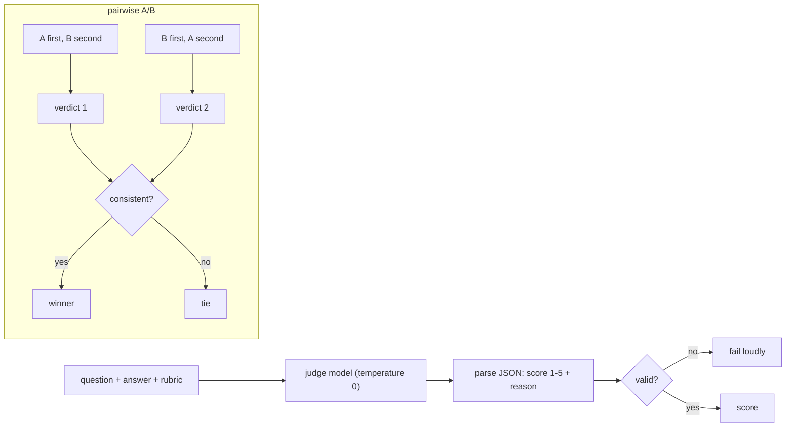

## Why it matters

Many qualities that matter — "is this answer helpful, polite, faithful to the source, compliant with policy?" — cannot be checked with string matching. A model can grade them at scale. But a judge is itself an unreliable model, so it must be designed and validated like any other classifier.

## Concept



**Known biases:**

| Bias | Mitigation |
|---|---|
| Position (prefers first/second) | Swap order, require consistency |
| Verbosity (prefers longer) | Rubric rewards concision; length-controlled comparisons |
| Self-preference (prefers its own model family) | Use a different judge model |
| Leniency / scale drift | Anchored rubric with examples per score |

**Rubric design:** specific and observable — "Mentions the port number and the operating system", "Every claim is supported by a cited source", "Declines when the sources do not contain the answer" — rather than "high quality".

## Build it from scratch

Absolute grading with a rubric and strict parsing:

<!-- code: lessons/p12-evals/src/main/java/dev/aieng/p12/LlmJudge.java#grade -->

Pairwise comparison with swap consistency:

<!-- code: lessons/p12-evals/src/main/java/dev/aieng/p12/LlmJudge.java#pairwise -->

The tests show the judge tolerating chatter around the JSON but rejecting out-of-range scores, a **biased judge** that always answers "1" producing a TIE instead of a false win, and a consistent judge producing the right winner in both orders.

## Now with the library

Spring AI provides judge-style evaluators:

```java
var evaluator = new RelevancyEvaluator(ChatClient.builder(judgeModel));
EvaluationResponse r = evaluator.evaluate(new EvaluationRequest(question, retrievedDocuments, answer));
assertTrue(r.isPass(), r.getFeedback());
```

`FactCheckingEvaluator` checks whether a claim is supported by documents. Use them in integration tests against a real model, alongside your own rubric judges.

## Production notes

- **Validate the judge:** label 50–100 outputs by hand and measure agreement before relying on it; re-check on judge model changes.
- **Log judge reasons** — they make failure analysis much faster.
- **Cost:** judging every production response is expensive; sample, or use a small judge model fine-tuned for the task.

## Exercises

1. **Easy** — Write a 1–5 rubric with anchor descriptions for "faithfulness to sources".
2. **Medium** — Add few-shot calibration examples (one answer per score level) to the `grade` prompt and test that they appear in the prompt.
3. **Hard** — With a local model as judge, grade 30 Tutor answers and compare with your own grades. Compute exact agreement and Cohen's kappa. Where does the judge disagree with you?

## Common mistakes

- Vague rubrics.
- Judging with the same model that generated the answer.
- Treating judge scores as ground truth.

## Further reading

- Zheng et al., "Judging LLM-as-a-Judge with MT-Bench and Chatbot Arena", NeurIPS 2023.
- Spring AI evaluation testing: <https://docs.spring.io/spring-ai/reference/api/testing.html>
