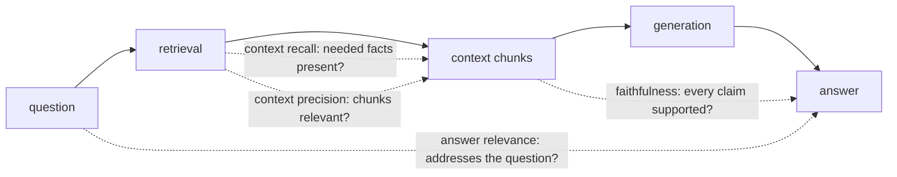

## Why it matters

"The answer was wrong" has two root causes with completely different fixes: **retrieval** did not supply the evidence, or **generation** did not use it (or invented more). RAG-specific metrics separate them.

## Concept



| Metric | Stage | Low score means |
|---|---|---|
| Context recall | Retrieval | Evidence missing — fix chunking, embeddings, hybrid search, k |
| Context precision | Retrieval | Noise in the prompt — rerank, raise threshold, lower k |
| Faithfulness | Generation | Hallucination — tighten grounding instructions, model choice |
| Answer relevance | Generation | Off-topic or evasive answers — prompt, query rewriting |

These are the core metrics popularised by RAGAS; they can be computed with labelled data, an LLM verifier, or both.

## Build it from scratch

<!-- code: lessons/p12-evals/src/main/java/dev/aieng/p12/RagMetrics.java#rag -->

Faithfulness splits the answer into claims and asks a verifier whether each is supported. In production the verifier is an LLM ("Is this claim supported by the context? yes/no"); the tests use a lexical verifier so they run offline. They show a faithful answer scoring 1.0 and an answer with an invented "hardware token" requirement scoring 0.5 — even though half of it is correct.

## Now with the library

```java
// Spring AI: relevancy of an answer to the question given the retrieved docs
var relevancy = new RelevancyEvaluator(ChatClient.builder(judgeModel));

// Fact checking (faithfulness-style) of a claim against documents
var factCheck = FactCheckingEvaluator.builder(ChatClient.builder(judgeModel)).build();
```

Get the retrieved documents from the RAG advisor's response context (Phase 9, lesson 4) so the evaluator sees exactly what the model saw.

## Production notes

- **Log retrieval with every answer** (chunk ids, scores) so you can compute these metrics on production samples.
- **Separate dashboards** for retrieval and generation metrics.
- **Unanswerable questions** need their own metric: correct refusal rate.

## Exercises

1. **Easy** — Write three answers for the VPN context: fully faithful, partly faithful, unfaithful. Predict and then compute their faithfulness.
2. **Medium** — Implement an LLM verifier `BiPredicate<String, String>` with a strict yes/no prompt and a fake model in tests.
3. **Hard** — Run the course Tutor over 20 questions with Ollama, compute context recall (using expected lesson ids), faithfulness (LLM verifier) and refusal accuracy. Which stage needs work first?

## Common mistakes

- Only measuring end-answer correctness.
- Evaluating faithfulness against documents other than those actually retrieved.
- Ignoring refusal cases.

## Further reading

- Es et al., "RAGAS: Automated Evaluation of Retrieval Augmented Generation", 2023.
- Spring AI evaluation documentation.
