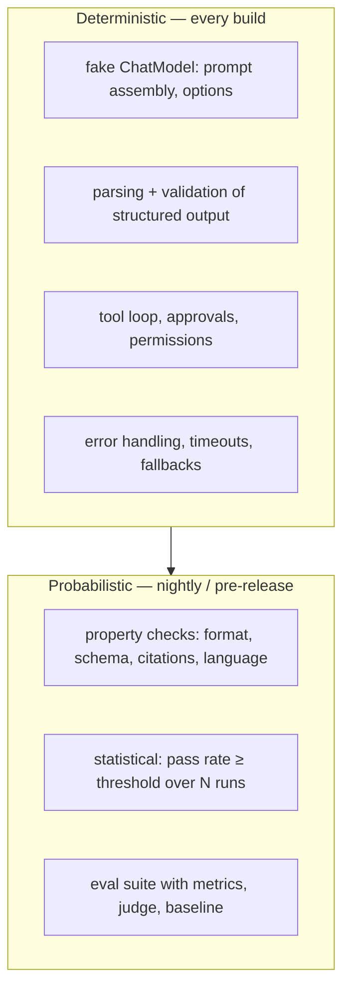

## Why it matters

"It's AI, it can't be tested" is wrong. Most of an AI feature is ordinary code that can be tested exactly; the model-dependent part needs different kinds of assertions, not none.

## Concept



| Assertion style | Example |
|---|---|
| Exact (fake model) | The system prompt contains the product name |
| Property | Output parses as `Triage`; every `[n]` citation is in range; answer is in German |
| Metamorphic | Paraphrasing the question should not change the extracted category |
| Statistical | ≥ 18 of 20 runs return a valid triage |
| Eval | Mean faithfulness ≥ 0.9 on the dataset, no regression vs baseline |

## Build it

You have written deterministic AI tests throughout this course:

| Phase | Test double | What it proved |
|---|---|---|
| 0 | JDK `HttpServer` fake Ollama | HTTP protocol, streaming parsing |
| 6 | `ScriptedChatModel` | System prompts, options, structured output, the tool loop, memory isolation |
| 9 | Keyword `EmbeddingModel` + `MockRestServiceServer` | RAG filters, empty-context behaviour, Liferay permissions |
| 10 | Scripted `Llm` lambdas | Agent stopping conditions, approvals |
| 11 | In-memory MCP transport | Protocol lifecycle and error semantics |

A statistical integration test against a real model (requires Docker; Testcontainers starts Ollama):

```java
@Testcontainers
class TriageIT {
    @Container
    static OllamaContainer ollama = new OllamaContainer("ollama/ollama:<pinned-version>");   // pin a tag, never latest

    @Test
    void triageIsValidAtLeast90PercentOfTheTime() throws Exception {
        ollama.execInContainer("ollama", "pull", "llama3.2");
        var api = OllamaApi.builder().baseUrl(ollama.getEndpoint()).build();
        var model = OllamaChatModel.builder().ollamaApi(api)
                .defaultOptions(OllamaChatOptions.builder().model("llama3.2").build()).build();
        var triage = new TicketTriage(model);

        int valid = 0;
        for (int i = 0; i < 20; i++) {
            try { triage.triage("After the upgrade, SSO login loops for all users"); valid++; }
            catch (RuntimeException ignored) { }
        }
        assertTrue(valid >= 18, "valid triages: " + valid + "/20");
    }
}
```

Name such classes `*IT` and run them with the Failsafe plugin in a separate pipeline stage, so the fast build stays fast.

## Now with the library

- **Spring Boot test slices** with `@MockitoBean ChatModel` or a `@TestConfiguration` providing a fake bean.
- **WireMock / MockRestServiceServer** to replay recorded provider HTTP responses.
- **Testcontainers** modules for Ollama, PostgreSQL/pgvector, Elasticsearch/OpenSearch, Qdrant and Redis.
- **Spring AI evaluators** (`RelevancyEvaluator`, `FactCheckingEvaluator`) inside integration tests.

## Production notes

- **Pin model versions in integration tests** or results drift with no code change.
- **Seed where supported** to reduce variance (still not a guarantee).
- **Track pass rates over time;** a slowly declining rate is an early warning.

## Exercises

1. **Easy** — Add a property assertion to a Phase 6 test: every citation `[n]` in an answer refers to a provided source.
2. **Medium** — Write a metamorphic test for `TicketTriage` with a fake model that returns a category based on keywords: two paraphrases must yield the same category.
3. **Hard** — Set up the Testcontainers integration test above in a new `*IT` class with Failsafe, and run it locally.

## Common mistakes

- No fakes, so every test hits a real model (slow, costly, flaky).
- Exact string assertions on real model output.
- Treating a single green run as proof.

## Further reading

- Testcontainers Ollama module: <https://java.testcontainers.org/modules/ollama/>
- Spring AI testing documentation.
