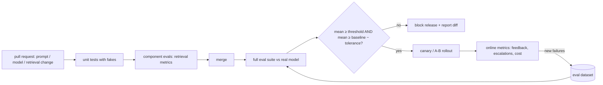

## Why it matters

Evals only protect you if they run automatically and can block a release. This lesson turns the toolkit into a gate — the AI equivalent of a failing unit test stopping a merge.

## Concept

A good eval report contains: dataset version, system version (prompt hashes, model ids), mean with **confidence interval**, per-category scores, the list of failed cases with outputs, and the diff against the baseline.

## Build it from scratch

<!-- code: lessons/p12-evals/src/main/java/dev/aieng/p12/EvalRunner.java#run -->

The bootstrap confidence interval:

<!-- code: lessons/p12-evals/src/main/java/dev/aieng/p12/EvalRunner.java#bootstrap -->

The test `evalRunnerGatesOnThresholdAndBaseline` runs a four-case dataset where the system answers a canteen question it should have refused. The overall mean is 0.75 — above the 0.7 threshold — but the per-tag report shows `refusal: 0.0`; and the same run **fails** when compared against a 0.90 baseline.

### Dogfooding: the course app's retrieval eval

The course application gates its own Tutor retrieval in the build: `app/src/test/java/.../TutorRetrievalEvalTest.java` runs a set of questions with known answering lessons through the hybrid search and fails the build if recall@5 or MRR drop below thresholds.

## Now with the library

- **JUnit 5:** run eval suites as tests tagged `@Tag("eval")`; include or exclude them by Maven profile.
- **CI:** GitHub Actions, GitLab CI or Jenkins jobs with an Ollama service container or a provider API key from the secret store.
- **Reports:** write JSON/Markdown reports to `target/` and publish as build artefacts; trend them in a dashboard (Langfuse, MLflow, or a simple database table).

## Production notes

- **Budget eval cost:** a 500-case suite with an LLM judge can cost real money per run; run full suites nightly and a smoke subset per PR.
- **Update baselines deliberately** — only on approved releases, never automatically on every run.
- **Flaky evals erode trust:** use enough cases, fixed seeds where possible, and tolerances informed by the confidence interval.

## Exercises

1. **Easy** — Add a `toMarkdown()` method to `Report` that prints mean, CI, per-tag scores and failures.
2. **Medium** — Store the baseline in `src/test/resources/evals/baseline.json` and load it in a JUnit test that runs `EvalRunner`.
3. **Hard** — Add a GitHub Actions workflow with an Ollama service container that pulls a small model and runs `*IT` eval tests nightly, publishing the Markdown report as an artefact.

## Common mistakes

- Evals that run only on a developer's laptop.
- Automatically overwriting the baseline.
- Reporting only the mean.

## Further reading

- Efron & Tibshirani, *An Introduction to the Bootstrap* (1993).
- Langfuse / MLflow LLM evaluation documentation.
