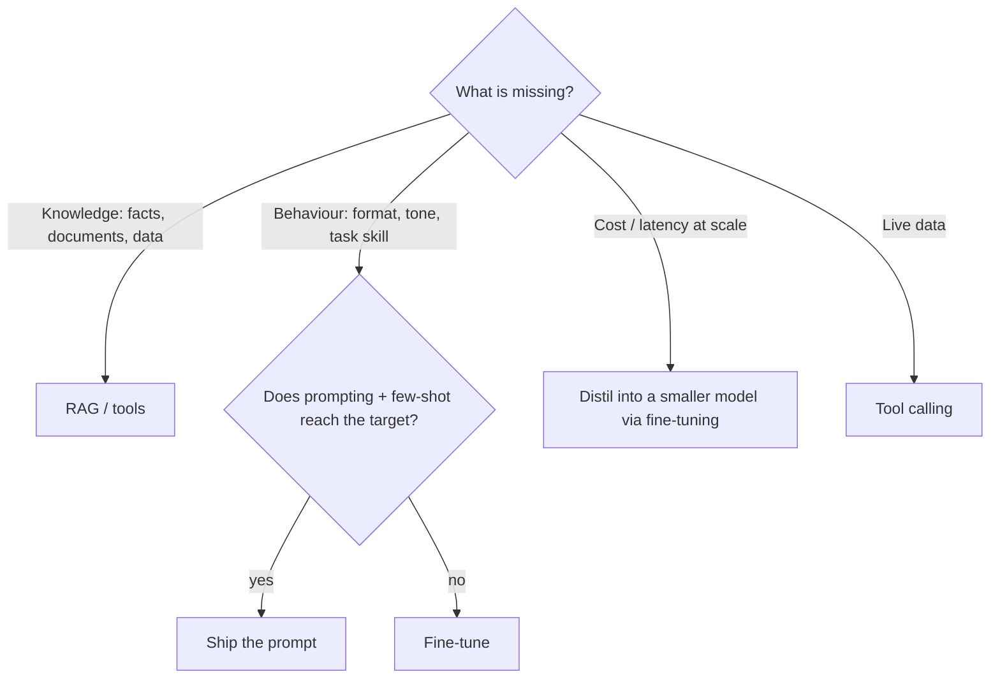

## Why it matters

Fine-tuning is the most over-requested and under-justified technique in enterprise AI. Done for the right reasons it cuts cost and improves consistency dramatically; done for the wrong ones it produces an expensive, stale model that still hallucinates.

## Concept

| Goal | Prompting | RAG | Fine-tuning |
|---|---|---|---|
| Add changing, citable knowledge | ✗ | ✓✓ | ✗ (stale, uncitable) |
| Consistent format/style | ✓ | – | ✓✓ |
| Domain jargon and conventions | ✓ | ✓ | ✓✓ |
| Narrow task at low cost | – | – | ✓✓ (small model) |
| Data residency with good quality | – | ✓ | ✓✓ (own small model) |
| Time to first result | hours | days | weeks |

**Fine-tuning variants:**

- **Full fine-tuning:** update all weights. Highest capacity, highest cost (Phase 3: ~16 bytes/parameter of GPU memory).
- **Parameter-efficient (PEFT), e.g. LoRA:** train small adapter matrices; the base model stays frozen (next lesson).
- **Preference tuning (DPO etc.):** teach which of two answers is better — for tone and policy.
- **Hosted fine-tuning APIs:** upload JSONL, get a model id — least infrastructure, data leaves your network.

## Build it

This phase walks the full pipeline, keeping Java everywhere except the GPU training step:

| Step | Language | Lesson |
|---|---|---|
| Understand LoRA | Java | 2 |
| Build and clean the dataset (JSONL) | Java | 3 |
| Train the adapter | Python (TRL + PEFT) | 4 |
| Quantise for serving | Java (concept) / llama.cpp tools | 5 |
| Serve and evaluate | Java (Ollama, Jlama, ONNX) + Phase 12 evals | 6 |

## Production notes

- **Establish the baseline first:** best prompt + RAG on the eval set. Fine-tuning must beat it on quality or cost.
- **Plan for re-training:** base model upgrades, new categories and data drift all require a new run.
- **Licences:** check the base model's licence for commercial use and fine-tuning restrictions.

## Exercises

1. **Easy** — For three AI features you know, decide prompting, RAG, fine-tuning or a combination, with one sentence each.
2. **Medium** — Estimate yearly cost for ticket triage at 50,000 tickets/day with (a) a hosted frontier model and (b) a fine-tuned 1B model on one GPU, using Phase 6's cost model.
3. **Hard** — Write the success criteria (metrics and thresholds) a fine-tuned triage model must meet before replacing the prompted baseline.

## Common mistakes

- Fine-tuning to add knowledge.
- No baseline or eval set.
- Forgetting the maintenance cost.

## Further reading

- OpenAI, "Fine-tuning best practices"; Anthropic and Google equivalents.
- Hu et al., "LoRA: Low-Rank Adaptation of Large Language Models", 2021.
