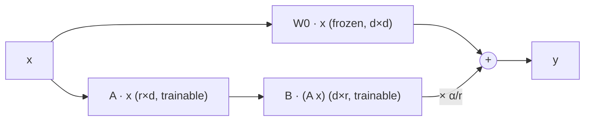

## Why it matters

LoRA (and its 4-bit variant QLoRA) is how almost everyone fine-tunes open models today: on one GPU, in hours, producing a few-megabyte adapter. Knowing the maths lets you choose rank, alpha and learning rate deliberately — and explain to stakeholders why a fine-tune fits on a laptop GPU.

## Concept

For a pretrained weight $W_0 \in \mathbb{R}^{d_{out} \times d_{in}}$, LoRA learns

$$W = W_0 + \frac{\alpha}{r}\, B A, \qquad B \in \mathbb{R}^{d_{out} \times r},\; A \in \mathbb{R}^{r \times d_{in}},\; r \ll d$$

- $W_0$ is **frozen** — no gradients, no optimiser state.
- $A$ starts small random, $B$ starts at **zero**, so $W = W_0$ at step 0.
- Only $A$ and $B$ train: $r(d_{in} + d_{out})$ parameters instead of $d_{in} d_{out}$.



**QLoRA** stores $W_0$ in 4-bit NF4 and computes in BF16, making 7–8B-parameter fine-tunes possible on a single consumer GPU.

## Build it from scratch

The forward pass never materialises $BA$ — two thin products instead:

<!-- code: lessons/p13-fine-tuning/src/main/java/dev/aieng/p13/Lora.java#forward -->

A gradient step with hand-derived gradients ($\partial L/\partial B = s\, \delta y\, (Ax)^\top$, $\partial L/\partial A = s\, (B^\top \delta y)\, x^\top$):

<!-- code: lessons/p13-fine-tuning/src/main/java/dev/aieng/p13/Lora.java#train -->

Merging for serving:

<!-- code: lessons/p13-fine-tuning/src/main/java/dev/aieng/p13/Lora.java#merge -->

`Lora.main` adapts a frozen 256×256 layer to a target that differs by a rank-1 change, training only **3.13%** of the parameters:

```text
trainable 2,048 of 65,536 parameters (3.13%)
epoch   0 loss 35.411884
epoch 150 loss 0.778343
epoch 300 loss 0.035536
epoch 600 loss 0.001338
```

A lesson from writing this: the first version used learning rate 0.05 and the loss **stalled at 5.76** — the steps were too large for this layer size. At 0.002 it converges. Learning rate is the first thing to check in any real LoRA run too.

The tests prove the three key properties: the adapter starts identical to the frozen model, training drives the loss below 5% of its start while touching only $A$ and $B$, and the merged matrix produces exactly the same outputs as base + adapter.

## Now with the library

In Hugging Face PEFT (Python), the same ideas are configuration:

```python
LoraConfig(r=16, lora_alpha=32, lora_dropout=0.05,
           target_modules=["q_proj", "k_proj", "v_proj", "o_proj", "gate_proj", "up_proj", "down_proj"])
```

`target_modules` chooses which of the transformer's matrices (Phase 5) get adapters; attention projections plus the FFN matrices is a common, strong default.

## Production notes

- **Adapters are tied to the exact base model** (version and weights). Record both together.
- **Multi-adapter serving:** one base model in GPU memory can serve many tenant- or task-specific adapters (vLLM, LoRAX, Ollama per model).
- **Rank:** 8–32 is typical; higher ranks rarely help narrow tasks and overfit small datasets.

## Exercises

1. **Easy** — Compute LoRA parameters for rank 8 on all seven projection matrices of one Llama-style block with $d = 2048$ and FFN size 8192.
2. **Medium** — Make the target a rank-4 change and train adapters of rank 1, 2, 4 and 8. Plot the final loss per rank.
3. **Hard** — Add AdamW (Phase 3) instead of plain gradient descent and compare convergence and sensitivity to the learning rate.

## Common mistakes

- Initialising both A and B randomly (the model starts broken).
- Copying a full fine-tuning learning rate into a LoRA run.
- Serving an adapter on a different base model version.

## Further reading

- Hu et al., "LoRA: Low-Rank Adaptation of Large Language Models", ICLR 2022.
- Dettmers et al., "QLoRA: Efficient Finetuning of Quantized LLMs", NeurIPS 2023.
