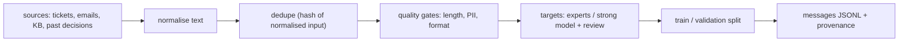

## Why it matters

Fine-tuning learns exactly what the data shows — including duplicates, inconsistencies, personal data and mistakes. Data preparation is ordinary data engineering, which is why it belongs in your Java/Spring estate, close to the source systems.

## Concept



The chat JSONL format (one conversation per line):

```json
{"messages":[{"role":"system","content":"You triage tickets."},
             {"role":"user","content":"Login fails after the upgrade to 7.4"},
             {"role":"assistant","content":"{\"category\":\"TECHNICAL\"}"}]}
```

Trainers apply the model's chat template to this and (with `assistant_only_loss`) compute the loss only on the assistant's tokens.

## Build it from scratch

<!-- code: lessons/p13-fine-tuning/src/main/java/dev/aieng/p13/DatasetBuilder.java#build -->

The test feeds seven raw examples: one near-duplicate (different case and punctuation) is dropped, one containing an email address and one too-short prompt are rejected, and the remaining four are split 3/1 into train and validation JSONL.

A subtle bug the test caught: the first version built each message with `Map.of(...)`, whose key order is unspecified, so lines came out as `{"content":…,"role":…}` in arbitrary order. Trainers don't care, but diffs, hashes and reviews do. Records serialise in declaration order, so the fix was `record Message(String role, String content)`.

## Now with the library

- **Spring Batch** for large datasets: a reader over the source system, processors for normalisation, PII filtering and labelling, and a writer producing sharded JSONL files with restartability.
- **Labelling with a strong model** (distillation): call a frontier model through `ChatClient` with structured output to propose targets, then sample for human review before training.
- **PII:** combine regexes (as here) with a dedicated detector (Phase 15) — regexes alone miss names and addresses.

## Production notes

- **Provenance:** store source id, labeller (human or model), date and dataset version for every example.
- **Consistency beats volume:** one output format, one style guide.
- **Leakage:** never let eval-set inputs appear in training data; check with the same hashing.

## Exercises

1. **Easy** — Add a check rejecting responses that are not valid JSON when the task requires JSON output.
2. **Medium** — Add class balancing: cap each category at the size of the smallest category × 3 and report the final distribution.
3. **Hard** — Write a Spring Batch job that reads tickets from a CSV, applies `DatasetBuilder` gates in a processor, and writes train/validation JSONL with a provenance sidecar file.

## Common mistakes

- Training on raw historical data with inconsistent formats.
- Personal data in training sets.
- Evaluating on data that also appears in training.

## Further reading

- Hugging Face TRL, dataset formats documentation.
- Zhou et al., "LIMA: Less Is More for Alignment", 2023 — small, curated datasets.
