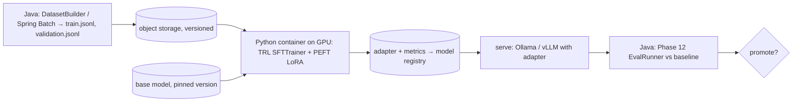

## Why it matters

Being honest about tooling builds trust: today, GPU training means Python. The skill for a Java architect is to keep that surface small, reproducible and integrated — data in, adapter out, evaluated by the same Java eval suite as everything else.

## Concept



Key training hyperparameters (all seen earlier in this course):

| Setting | Typical LoRA value | From |
|---|---|---|
| `learning_rate` | 1e-4 – 2e-4 | Phase 3 lesson 5; lesson 2 here |
| `lr_scheduler_type`, `warmup_ratio` | cosine, 0.03 | Phase 3 lesson 5 |
| `num_train_epochs` | 1–3 | Overfitting (Phase 2) |
| `r`, `lora_alpha` | 16, 32 | Lesson 2 |
| `assistant_only_loss` | true | Lesson 3 |
| `eval_strategy`, `load_best_model_at_end` | epoch, true | Phase 3 lesson 6 |

## Build it

The training script (kept in `lessons/p13-fine-tuning/python/`, not run by the Maven build):

<!-- code: lessons/p13-fine-tuning/python/train_lora.py -->

Run it:

```bash
cd lessons/p13-fine-tuning/python
python -m venv .venv && source .venv/bin/activate
pip install torch transformers datasets peft trl bitsandbytes accelerate
python train_lora.py --model meta-llama/Llama-3.2-1B-Instruct --qlora \
    --train ../target/sft/train.jsonl --validation ../target/sft/validation.jsonl --out ./adapter
```

No GPU? Use a hosted fine-tuning service that accepts the same `messages` JSONL, or a notebook environment with a GPU — the Java parts of the pipeline do not change.

## Now with the library

Alternatives to running TRL yourself:

| Option | Notes |
|---|---|
| Unsloth | Faster, lower-memory LoRA training, same data format |
| Axolotl | YAML-configured training on top of the HF stack |
| Hosted fine-tuning APIs | Upload JSONL, receive a model id; data leaves your network |
| Cloud training services | Managed GPUs with your container |

## Production notes

- **Pin everything:** base model revision, library versions, random seed, dataset version.
- **Track experiments** (MLflow): loss curves, eval metrics, hyperparameters, data version.
- **Watch for overfitting:** validation loss rising while training loss falls → fewer epochs, lower rank or more data.
- **Check the licence** of the base model and dataset sources.

## Exercises

1. **Easy** — Generate `train.jsonl` and `validation.jsonl` with `DatasetBuilder` from 50 examples you write, and inspect them.
2. **Medium** — Write a `Dockerfile` for the training script with pinned versions and a non-root user.
3. **Hard** — Run a QLoRA fine-tune of a 1B model on your triage dataset (local GPU or hosted notebook), serve it (lesson 6), and compare it with the prompted base model using `EvalRunner`.

## Common mistakes

- Unpinned library versions (TRL and Transformers APIs change frequently).
- Training without a validation split.
- Judging success by training loss alone.

## Further reading

- Hugging Face TRL SFTTrainer documentation.
- Hugging Face PEFT documentation.
- Unsloth documentation.
