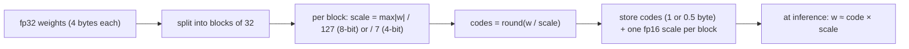

## Why it matters

Quantisation is why a 7B model runs on a laptop and why self-hosted inference can be affordable. It is also a quality trade-off you must measure, not assume.

## Concept

Store each weight as a small integer code plus a shared scale:

$$\text{scale}_b = \frac{\max_{i \in b} |w_i|}{2^{bits-1}-1}, \qquad q_i = \text{round}\!\left(\frac{w_i}{\text{scale}_b}\right), \qquad \hat{w}_i = q_i \cdot \text{scale}_b$$



| Format | Where | Notes |
|---|---|---|
| GGUF Q8_0, Q4_0, Q4_K_M, Q5_K_M… | llama.cpp, Ollama, Jlama | Block-wise; "K-quants" use smarter grouping |
| NF4 | bitsandbytes (QLoRA training) | 4-bit levels matched to a normal distribution |
| GPTQ, AWQ | vLLM, TGI | Calibration-based, minimise output error |
| FP8 / INT8 | Modern GPUs, ONNX Runtime | Hardware-accelerated |

## Build it from scratch

<!-- code: lessons/p13-fine-tuning/src/main/java/dev/aieng/p13/Quantize.java#quantize -->

`Quantize.main` on one million Gaussian weights with a single outlier:

```text
fp32: 4,194,304 bytes
8-bit, block 32     :  1,114,112 bytes, relative error 0.0054
4-bit, block 32     :    589,824 bytes, relative error 0.0969
4-bit, block 1048576:    524,290 bytes, relative error 0.9973
```

Three lessons: int8 is nearly lossless at ¼ the size; 4-bit halves it again with visible error; and **one global scale is catastrophic** — the outlier makes the scale so large that almost every ordinary weight rounds to zero. Block-wise scales cost a few percent of extra bytes and fix it. The tests assert all three relationships.

## Now with the library

```bash
# llama.cpp tools: convert a Hugging Face model (or merged LoRA) to GGUF and quantise it
python convert_hf_to_gguf.py ./merged-model --outfile model-f16.gguf
./llama-quantize model-f16.gguf model-q4_k_m.gguf Q4_K_M
```

```text
# Ollama Modelfile
FROM ./model-q4_k_m.gguf
```

In Java, Jlama loads quantised models directly, and ONNX Runtime supports INT8 quantised ONNX models (`onnxruntime.quantization` tools produce them).

## Production notes

- **Evaluate every quantisation level** on your eval set — small models degrade faster.
- **Quantise the KV cache** too for long contexts (Phase 5) where supported.
- **Measure tokens/s and TTFT** on the actual target hardware.

## Exercises

1. **Easy** — Add 6-bit to `Quantize.main` and place it in the size/error table.
2. **Medium** — Implement asymmetric quantisation (scale + zero point, using min and max) and compare its error with symmetric on weights shifted to have a non-zero mean.
3. **Hard** — Pull `llama3.2:1b` in two quantisations from Ollama (e.g. Q4_K_M and Q8_0), run 30 eval cases through each with `EvalRunner`, and compare quality and tokens per second.

## Common mistakes

- Assuming 4-bit is "free".
- Comparing quantised local models with full-precision hosted ones without saying so.
- Forgetting KV-cache memory when sizing hardware.

## Further reading

- Dettmers et al., "LLM.int8()", 2022.
- Frantar et al., "GPTQ", 2022; Lin et al., "AWQ", 2023.
- llama.cpp quantisation documentation.
