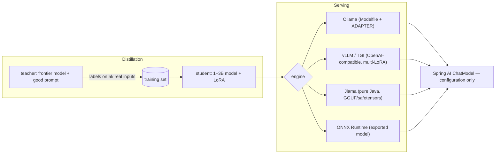

## Why it matters

A fine-tuned model is only valuable once it is served reliably and evaluated against what it replaces. And distillation is often the real business case: frontier-model quality on a narrow task at small-model cost.

## Concept



**Distillation variants:**

- **Label distillation (most common):** the teacher produces outputs; the student is fine-tuned on them (lesson 3's pipeline with the teacher as labeller).
- **Logit distillation:** the student matches the teacher's full next-token distributions (minimises KL divergence, Phase 1) — needs access to teacher logits, so mostly for open models.

## Build it

Ollama can serve a LoRA adapter on top of its base model:

<!-- code: lessons/p13-fine-tuning/python/Modelfile -->

```bash
ollama create support-triage -f Modelfile
```

Then point Spring AI at it — no code change in `TicketTriage` from Phase 6:

```yaml
spring:
  ai:
    ollama:
      chat:
        model: support-triage
```

For GPU throughput, vLLM serves an OpenAI-compatible API (with LoRA adapters selectable per request); use Spring AI's OpenAI provider with `spring.ai.openai.base-url` pointing at it.

### Evaluate the switch

Run the same eval set through the old (prompted frontier) and new (distilled) models with `EvalRunner` (Phase 12), and compare quality, latency and cost per 1,000 requests. Promote only if quality is within tolerance and the cost or latency gain is real.

## Now with the library

| Engine | Java integration |
|---|---|
| Ollama | Spring AI Ollama provider; LangChain4j Ollama |
| vLLM / TGI | Spring AI OpenAI provider (OpenAI-compatible API) |
| Jlama | In-process pure Java; LangChain4j Jlama integration |
| ONNX Runtime | In-process via ONNX Runtime Java / DJL (best for encoders, classifiers, small models) |

## Production notes

- **Version model names** (`triage-v3`) and keep the previous version deployable for rollback.
- **Keep a fallback route** to the prompted large model for low-confidence cases.
- **Re-distil** when the teacher, the task or the data distribution changes.
- **Licences and terms:** check that your teacher's terms allow training on its outputs and that the student's base model licence fits your use.

## Exercises

1. **Easy** — Create the `support-triage` model in Ollama from a base model with only the `SYSTEM` and `PARAMETER` lines (no adapter) and call it from `TicketTriage`.
2. **Medium** — Write a distillation job: use a strong model through `ChatClient` with structured output to label 200 tickets, then feed them to `DatasetBuilder`.
3. **Hard** — Add a router: use the distilled model first and escalate to the large model when its structured output fails validation or a confidence field is below 0.7. Measure the escalation rate and blended cost.

## Common mistakes

- Comparing the student with the teacher on different prompts or data.
- No fallback path.
- Ignoring provider terms on training with outputs.

## Further reading

- Hinton, Vinyals & Dean, "Distilling the Knowledge in a Neural Network", 2015.
- Ollama Modelfile reference (ADAPTER instruction).
- vLLM LoRA adapters documentation; Jlama project.
