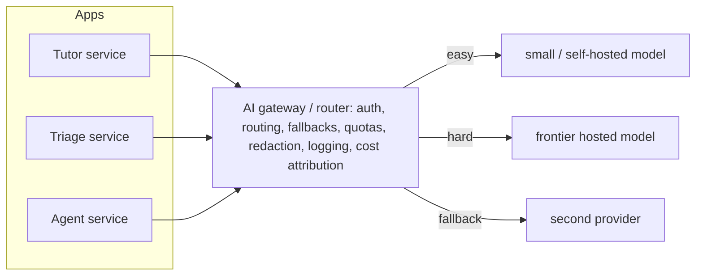

## Why it matters

Once AI features go beyond a prototype, every team needs the same things: credentials, routing, fallbacks, quotas, logging and cost reports. Doing it per application duplicates effort and loses control; a gateway or a shared router library centralises it.

## Concept



**Routing strategies:**

| Strategy | Example |
|---|---|
| Static per feature | Triage → fine-tuned 1B; Tutor → mid-size model |
| Heuristic | Long or "compare/analyse" prompts → strong model |
| Classifier | A small model or embedding classifier predicts difficulty |
| Cascade | Try the cheap model; escalate on low confidence or failed validation |
| Cost/latency aware | Choose by current price, queue depth or p95 latency |

## Build it from scratch

<!-- code: lessons/p14-llmops/src/main/java/dev/aieng/p14/ModelRouter.java#route -->

Each model carries its own circuit breaker (next lesson), and every attempt is recorded. The test routes "Reset my password" to the small model, and "Compare the two contracts step by step" to the hard route, where the primary model is down — the router falls back to the backup and reports `[large:overloaded, backup:ok]`.

## Now with the library

In Spring AI, a router is a service holding several `ChatClient`s:

```java
@Configuration
class Models {
    @Bean @Qualifier("small") ChatClient small(OllamaChatModel m) { return ChatClient.create(m); }
    @Bean @Qualifier("large") ChatClient large(OpenAiChatModel m) { return ChatClient.create(m); }
}
```

(With several providers on the classpath, set `spring.ai.model.chat` to the primary and create the others' `ChatModel` beans explicitly, or point both at an OpenAI-compatible gateway with different model names.) For a shared gateway, Spring Cloud Gateway with custom filters, or a dedicated product exposing an OpenAI-compatible API, lets every Spring AI application use `spring.ai.openai.base-url` to reach it.

## Production notes

- **Evaluate per route.** A router that sends 80% of traffic to a small model must prove that 80% meets the quality bar.
- **Log the routing decision** (route, model, attempts) with every request.
- **Fallback models need their own evals** — a fallback that answers badly is an outage in disguise.

## Exercises

1. **Easy** — Add a route for prompts containing code blocks (```` ``` ````) that prefers a code-specialised model.
2. **Medium** — Implement a cascade: call the small model with structured output; escalate to the large model when validation fails. Test with fakes.
3. **Hard** — Replace `looksHard` with an embedding-based classifier trained on 100 labelled prompts (logistic regression from Phase 2 on embeddings) and measure routing accuracy.

## Common mistakes

- Routing without per-route evaluation.
- Fallback to a model with very different behaviour and no warning.
- A gateway that becomes a single point of failure.

## Further reading

- Ong et al., "RouteLLM: Learning to Route LLMs with Preference Data", 2024.
- LiteLLM, Kong AI Gateway documentation.
