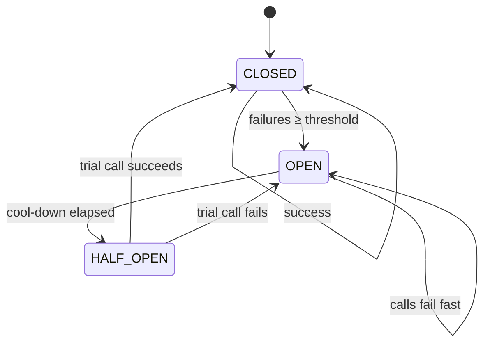

## Why it matters

LLM APIs have higher latency variance, stricter rate limits and more frequent incidents than most dependencies you know. Applying classic resilience patterns correctly is the difference between a degraded feature and a site outage.

## Concept



| Pattern | Purpose | LLM-specific notes |
|---|---|---|
| Timeouts | Bound waiting | Separate connect / time-to-first-token / total; streaming needs idle timeouts |
| Retry + jittered backoff | Ride out transient errors | Retry 429/5xx/timeouts only; respect `Retry-After` |
| Circuit breaker | Fail fast during outages | One per provider/model |
| Fallback | Keep serving | Another model, cached answer, sources-only, or queue |
| Bulkhead | Isolate | Separate pools/limits per feature so one feature can't starve others |

**Full-jitter backoff:** wait a random duration in $[0, \min(\text{cap}, \text{base} \cdot 2^{attempt})]$.

## Build it from scratch

<!-- code: lessons/p14-llmops/src/main/java/dev/aieng/p14/Resilience.java#retry -->

<!-- code: lessons/p14-llmops/src/main/java/dev/aieng/p14/Resilience.java#breaker -->

The tests use an injected `Sleeper` and a movable `Clock`, so they verify timing logic without sleeping: two jittered waits within their ceilings before success; a 400 never retried; the breaker opening after three failures, failing fast without calling the provider, and closing again after the cool-down.

## Now with the library

- **Spring AI** has built-in retry for provider calls (`spring.ai.retry.*` properties: max attempts, backoff, which status codes to retry).
- **Resilience4j** provides circuit breakers, rate limiters, bulkheads and time limiters with Spring Boot integration and Micrometer metrics:

```java
@CircuitBreaker(name = "openai", fallbackMethod = "fallback")
public String answer(String q) { return largeClient.prompt().user(q).call().content(); }

String fallback(String q, Throwable t) { return smallClient.prompt().user(q).call().content(); }
```

- **HTTP client timeouts:** configure the `RestClient`/`WebClient` used by the provider (Spring AI exposes customisation hooks) — the defaults are often far too long for interactive use.

## Production notes

- **Don't stack retries:** Spring AI retry + Resilience4j retry + gateway retry can multiply into dozens of attempts.
- **Budget the latency:** retries must fit the user-facing timeout.
- **Alert on breaker state changes** and fallback rates, not just errors.

## Exercises

1. **Easy** — Honour a `Retry-After` header: extend `ModelException` with an optional duration and use it instead of the computed backoff.
2. **Medium** — Configure Spring AI's retry properties for a service and explain each value.
3. **Hard** — Wrap a `ChatClient` call with Resilience4j `CircuitBreaker` and `TimeLimiter`, test the fallback with a fake model that sleeps, and expose the breaker metrics through Actuator.

## Common mistakes

- Retrying non-retryable errors.
- Default multi-minute timeouts on interactive endpoints.
- No fallback, so a provider outage becomes your outage.

## Further reading

- AWS Architecture Blog, "Exponential Backoff and Jitter" (2015).
- Resilience4j documentation; Spring AI retry properties.
