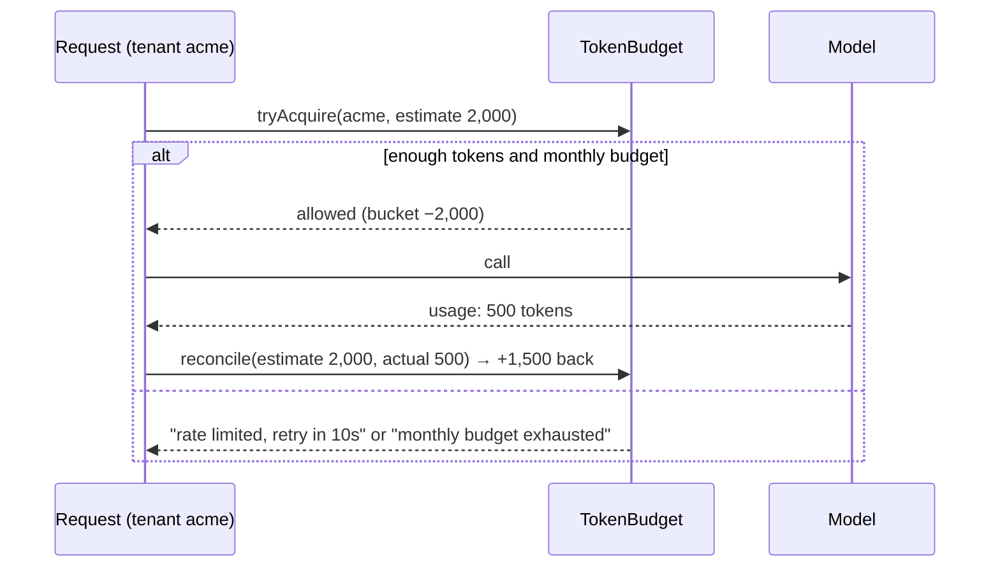

## Why it matters

LLM costs scale with usage you don't fully control: a single tenant, a buggy agent loop or a scraping bot can burn a month's budget in an afternoon. Rate limits and budgets are financial safety mechanisms, not just fairness tools.

## Concept

**Token bucket:** each tenant has a bucket of capacity $C$ tokens that refills at $C/60$ tokens per second (for a per-minute limit). A request may proceed if the bucket holds at least its estimated tokens.

| Control | Protects against |
|---|---|
| Max input/output tokens per request | Giant prompts, runaway generations |
| Token bucket per tenant/user | Bursts, abuse, noisy neighbours |
| Monthly budget per tenant/feature | Spend beyond plan or forecast |
| Global quota guard | Provider rate limits for the whole organisation |
| Kill switch | Incidents |

## Build it from scratch

<!-- code: lessons/p14-llmops/src/main/java/dev/aieng/p14/TokenBudget.java#acquire -->

The test drives it with a movable clock: a 6,000-tokens-per-minute bucket admits 5,000, refuses a further 2,000 with "retry in 10s", serves another tenant independently, refills after ten seconds, returns unused reservation on reconcile, and finally refuses with "monthly budget exhausted".

## Now with the library

- **Resilience4j RateLimiter** limits *calls* per period — combine it with a token budget like this one for cost.
- **Distributed limits:** a single JVM's map does not limit a cluster; use Redis (e.g. Bucket4j with a Redis backend) for shared buckets.
- **Spring AI usage:** `ChatResponse.getMetadata().getUsage()` gives prompt and completion tokens for reconciliation.

## Production notes

- **Estimate conservatively** (prompt tokens + max_tokens) and reconcile — never trust estimates for billing.
- **Tag every token metric** with tenant, feature and model (next lessons).
- **Degrade before you deny:** switch over-budget tenants to a cheaper model if the product allows.
- **Reconcile with invoices** monthly; differences reveal untracked usage.

## Exercises

1. **Easy** — Add a soft-limit warning at 80% of the monthly budget to `Decision`.
2. **Medium** — Implement the same bucket with Bucket4j and compare behaviour in a test.
3. **Hard** — Make the budget distributed with Redis (Testcontainers) and prove that two `TokenBudget` instances share one tenant's bucket.

## Common mistakes

- Request-count limits only.
- Per-instance limits in a scaled-out deployment.
- No cost attribution, so nobody knows which feature is expensive.

## Further reading

- Bucket4j documentation.
- FinOps Foundation, "FinOps for AI" working group materials.
