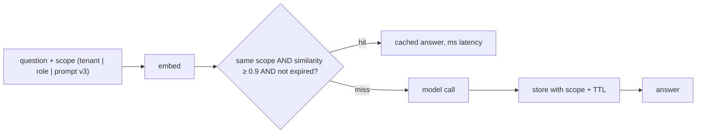

## Why it matters

Support and documentation assistants receive the same questions thousands of times in different words. A semantic cache can serve a large share from memory in milliseconds — if it never serves the wrong answer to the wrong person.

## Concept

Rails:

1. **Scope** — exact match on tenant, permission set and prompt/model version.
2. **Threshold** — strict, calibrated on labelled pairs of equivalent / non-equivalent questions.
3. **TTL and invalidation** — expire entries, and purge when source content changes.
4. **Eligibility** — only cache answers that are not personalised and had no side effects.

## Build it from scratch

<!-- code: lessons/p14-llmops/src/main/java/dev/aieng/p14/SemanticCache.java#cache -->

The test stores one answer and shows: a paraphrase in the same scope hits; another tenant misses; a new prompt version misses; an unrelated question misses; and after the TTL the entry is gone.

## Now with the library

- **Spring Cache** (`@Cacheable`) for exact-match caching (Phase 7) — always the first step.
- **Vector stores with TTL** (Redis, Elasticsearch) for semantic caches at scale; Spring AI's `VectorStore` with metadata filters on the scope.
- **Provider prompt caching** (Phase 7) is complementary: it reduces cost of *misses* with shared prefixes.

## Production notes

- **Measure wrong hits,** not just hit rate: sample cached responses and verify equivalence.
- **Never cache errors, refusals caused by outages, or partial streams.**
- **Privacy:** cached answers may contain personal data; apply the same retention rules as logs.

## Exercises

1. **Easy** — Add `invalidateScope(String scopePrefix)` and test it.
2. **Medium** — Calibrate the threshold: label 40 question pairs (equivalent or not), compute similarities with a real embedding model, and choose the threshold that keeps wrong hits at zero.
3. **Hard** — Implement the cache on Redis with vector search and TTL, using Testcontainers in the test.

## Common mistakes

- Global, unscoped caches.
- Thresholds copied from blog posts.
- Caching personalised answers.

## Further reading

- Bang, "GPTCache", 2023.
- Redis vector similarity search documentation.
