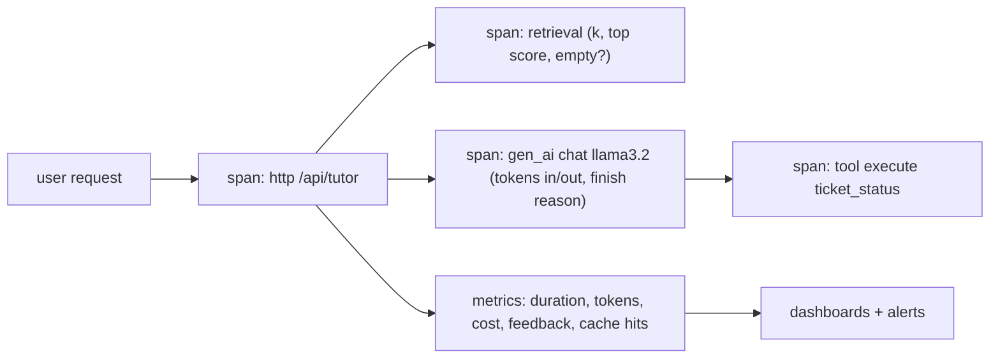

## Why it matters

AI features fail in ways classic monitoring misses: an answer can be fast, HTTP 200, and wrong. You need operational metrics *and* quality signals, tied to cost — while respecting that prompts often contain sensitive data.

## Concept



**OpenTelemetry GenAI conventions** (selected):

| Name | Kind | Key attributes |
|---|---|---|
| `gen_ai.client.operation.duration` | Histogram | `gen_ai.operation.name`, `gen_ai.request.model`, `gen_ai.provider.name` |
| `gen_ai.client.token.usage` | Histogram | `gen_ai.token.type` (`input`/`output`), `gen_ai.request.model` |
| Spans `chat {model}`, `execute_tool {name}` | Traces | `gen_ai.usage.input_tokens`, `gen_ai.response.finish_reasons` |

Add your own business dimensions — `feature`, `tenant`, `route`, `prompt.version` — carefully, watching metric cardinality.

## Build it from scratch

<!-- code: lessons/p14-llmops/src/main/java/dev/aieng/p14/LlmMetrics.java#record -->

The test records three calls (one failing) and reads the registry back: total input and output tokens, a timer tagged with the failure type, and token usage attributable to the `tutor` feature.

## Now with the library

Spring AI instruments `ChatClient`, `ChatModel`, `EmbeddingModel`, `VectorStore` and tool calls through the Micrometer Observation API out of the box:

```yaml
management:
  tracing:
    sampling:
      probability: 1.0            # lower in production
  otlp:
    tracing:
      endpoint: http://otel-collector:4318/v1/traces
spring:
  ai:
    chat:
      observations:
        log-prompt: false          # keep prompt content out of telemetry unless policy allows
        log-completion: false
```

With `spring-boot-starter-actuator` and an OTLP exporter, traces flow to Jaeger, Tempo, Grafana or any OpenTelemetry backend; dedicated LLM observability tools (Langfuse, Arize Phoenix, others) also accept OTLP GenAI spans.

## Production notes

- **Content capture off by default;** enable sampled, redacted capture in non-production or with explicit approval.
- **Alert on quality proxies** (feedback rate, refusal spikes, empty retrievals), not only on errors.
- **Cost dashboards per feature and tenant** reviewed weekly.
- **Correlate** model and prompt versions with every metric to see the effect of releases.

## Exercises

1. **Easy** — Add a `gen_ai.response.finish_reason` tag (e.g. `stop`, `length`) to `observe` and count truncated answers.
2. **Medium** — Enable Actuator and Prometheus in the course app and find Spring AI's chat metrics at `/actuator/prometheus` after asking the Tutor a question.
3. **Hard** — Run an OpenTelemetry Collector and Jaeger with Docker Compose, export the course app's traces, and inspect one Tutor request end to end.

## Common mistakes

- Logging full prompts with personal data.
- High-cardinality tags (user ids, raw prompts) on metrics.
- No quality signals at all.

## Further reading

- OpenTelemetry Semantic Conventions for Generative AI: <https://opentelemetry.io/docs/specs/semconv/gen-ai/>
- Spring AI observability: <https://docs.spring.io/spring-ai/reference/observability/index.html>
