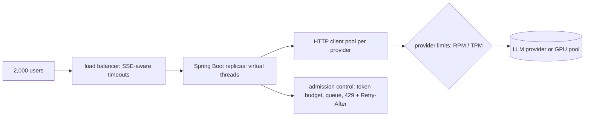

## Why it matters

LLM calls are slow (seconds), long-lived (streaming) and rate-limited by someone else. Classic thread-per-request sizing and CPU-based autoscaling fail here; the right concurrency model and realistic load tests prevent painful launches.

## Concept



| Concern | Guidance |
|---|---|
| Threads | `spring.threads.virtual.enabled=true`; avoid `synchronized` around blocking calls in hot paths (pinning) on older JDKs |
| Reactive | WebFlux end-to-end if the stack is already reactive; Spring MVC can still return `Flux` for SSE |
| Connections | Size the provider HTTP pool for expected concurrency; set keep-alive and idle timeouts |
| Back-pressure | Bounded queues; reject early with `Retry-After` instead of timing out late |
| Autoscaling | On in-flight requests or queue depth, not CPU |
| Self-hosted GPUs | Throughput limited by batch size and KV cache (Phase 5); use continuous batching engines |

## Build it

The course app runs on virtual threads (`spring.threads.virtual.enabled: true` in its `application.yml`), and Phase 10's `Workflows.parallel` fans out model calls on a virtual-thread executor. A streaming endpoint from Phase 6:

```java
@GetMapping(value = "/api/chat/stream", produces = MediaType.TEXT_EVENT_STREAM_VALUE)
Flux<String> stream(@RequestParam String q) {
    return assistant.stream(q);          // ChatClient ... .stream().content() with a timeout
}
```

### Load testing realistically

Generate load with Gatling (Java DSL), k6 or JMeter, drawing prompts from a sample of real (anonymised) traffic:

```java
// Gatling Java DSL (reference snippet)
ScenarioBuilder tutor = scenario("tutor")
        .feed(csv("questions.csv").random())
        .exec(http("ask").post("/tutor").formParam("question", "#{question}"));
setUp(tutor.injectOpen(rampUsers(500).during(120))).protocols(http.baseUrl("http://localhost:8080"));
```

Point it at a **fake model server** (Phase 0's `HttpServer` fake with artificial delays and token-proportional latency) to load-test your own service without paying for tokens; then run a smaller test against the real provider to verify limits.

## Production notes

- **Know your provider quotas** (RPM/TPM per model and region) and request increases before launch.
- **Separate pools per feature** (bulkheads) so a heavy batch job can't starve interactive users.
- **Measure TTFT and inter-token latency** for streaming, not just total time.

## Exercises

1. **Easy** — Calculate how many concurrent requests one provider key supports at 200k tokens/minute with 3,000 tokens per request and 8 s average latency.
2. **Medium** — Build a fake LLM HTTP server whose latency is `200 ms + 20 ms × output tokens`, and load-test the course Tutor against it with 200 concurrent users on virtual threads vs a fixed pool of 50 platform threads.
3. **Hard** — Add admission control to the Tutor endpoint: when more than N requests are in flight, return 429 with `Retry-After`; verify with the load test.

## Common mistakes

- CPU-based autoscaling for I/O-bound AI services.
- Load tests with one short prompt.
- Ignoring proxy buffering and timeouts for SSE.

## Further reading

- JEP 444: Virtual Threads.
- Gatling Java DSL documentation.
