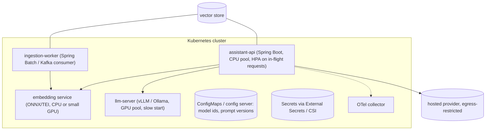

## Why it matters

AI services add new deployable parts — model servers, embedding services, vector stores, ingestion workers — and new kinds of change: prompts, models and thresholds. A clean deployment model keeps them independently scalable and safely releasable.

## Concept



| Change type | Release mechanism |
|---|---|
| Application code | CI/CD, container image, rolling update |
| Prompt version | Config change + eval gate + canary |
| Model id / provider | Config change + full eval + canary, fallback ready |
| Embedding model | Blue/green re-index (Phase 4), switch alias |
| Self-hosted model weights | New model-server deployment, warm-up, traffic shift |

## Build it

This repository's `docker-compose.yml` runs the course stack locally — the app, Ollama (with the chat and embedding models pulled on start) and PostgreSQL with pgvector for the Phase 8 exercises:

```bash
docker compose up -d
```

A container image for any Spring Boot AI service needs no Dockerfile:

```bash
./mvnw -pl app spring-boot:build-image -Dspring-boot.build-image.imageName=ai-course:1.0.0
```

For Kubernetes, the model server needs a readiness probe that waits for the model to load, resource requests for GPU (`nvidia.com/gpu: 1`) and node selectors for the GPU pool; the Spring app needs liveness/readiness from Actuator (`/actuator/health/liveness`, `/actuator/health/readiness`).

## Now with the library

| Need | Option |
|---|---|
| GPU serving | vLLM, Hugging Face TGI, NVIDIA NIM/Triton, Ollama (simpler) |
| Kubernetes model operators | KServe, KubeAI |
| Config | Spring Cloud Config, Kubernetes ConfigMaps + `@ConfigurationProperties`, feature flags |
| Secrets | Vault, cloud secret managers, External Secrets Operator |
| Egress control | Network policies, egress gateways allowing only approved AI endpoints |

## Production notes

- **Warm-up:** load models and run a test inference before marking ready; cold starts of tens of seconds are normal.
- **Data residency:** pin hosted model endpoints to approved regions; restrict egress elsewhere.
- **Disaster recovery:** the vector index must be rebuildable from sources; back up conversation and audit stores.
- **Cost:** GPU nodes are expensive — scale to zero for non-production, share via multi-adapter serving.

## Exercises

1. **Easy** — Build the course app image with `spring-boot:build-image` and run it against the compose Ollama.
2. **Medium** — Write Kubernetes manifests (Deployment, Service, ConfigMap, HPA) for the course app with Actuator probes and model settings from the ConfigMap.
3. **Hard** — Add an Ollama Deployment with a PersistentVolume for models, an init job that pulls them, and a readiness probe that checks `/api/tags` lists the chat model.

## Common mistakes

- Model server and application in the same pod with the same scaling.
- Prompts baked into images with no runtime switch.
- Unrestricted egress to any AI API.

## Further reading

- Spring Boot container images: <https://docs.spring.io/spring-boot/reference/packaging/container-images/index.html>
- vLLM deployment documentation; KServe documentation.
