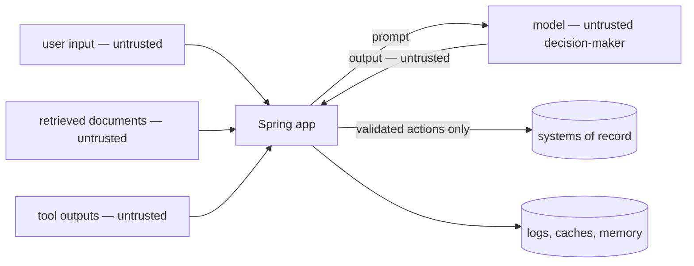

## Why it matters

AI features introduce a component that follows instructions found *anywhere* in its context. Classic application security still applies — and a new class of attacks targets the model's instruction-following itself. A structured threat model keeps both in view.

## Concept

### OWASP Top 10 for LLM Applications (2025) → controls in this course

| Risk | Control | Built in |
|---|---|---|
| LLM01 Prompt injection | Delimit data, heuristics, least privilege, approvals | Phase 7 L1, this phase L2, Phase 10 L3 |
| LLM02 Sensitive information disclosure | Permission-aware retrieval, PII redaction, scoped caches | Phase 9 L6, this phase L3, Phase 14 L4 |
| LLM03 Supply chain | Vetted models and MCP servers, safe formats (no pickle), pinned versions | Phase 3 L7, Phase 11 L5 |
| LLM04 Data and model poisoning | Curated ingestion and training data, provenance | Phase 9 L2, Phase 13 L3 |
| LLM05 Improper output handling | Validate/escape output, structured output, output guard | Phase 6 L5, this phase L4 |
| LLM06 Excessive agency | Narrow tools, run as user, approvals, budgets | Phase 10 L3/L6 |
| LLM07 System prompt leakage | No secrets in prompts, canary detection | Phase 7 L1, this phase L4 |
| LLM08 Vector and embedding weaknesses | Filters inside retrieval, tenant isolation | Phase 8 L5 |
| LLM09 Misinformation | Grounding, citations, faithfulness evals, refusals | Phase 9, Phase 12 |
| LLM10 Unbounded consumption | Token budgets, rate limits, max tokens, timeouts | Phase 14 L2/L3 |

## Build it

This phase adds the remaining controls as small, testable components:

| Component | Lesson |
|---|---|
| `InjectionDetector` | 2 — prompt injection |
| `PiiRedactor` | 3 — personal data |
| `OutputGuard` | 4 — output guardrails |
| `AiActTriage` | 5 — governance |
| `AuditLog` | 6 — audit and red-teaming |

## Now with the library

Security for AI services is mostly ordinary Spring Security plus discipline: OAuth2 resource servers, method security on tool beans, `ToolContext` for identity, network policies for egress, secret managers for keys. Managed guardrail services and open-source guard models (classifiers for injection, toxicity, PII) can add layers — evaluate them like any classifier (precision at your base rate, Phase 1 lesson 4).

## Production notes

- **Defence in depth:** no single control stops prompt injection; layer them.
- **Assume breach of the model's judgement:** design so a fully manipulated model can still only do what the user could do anyway.
- **Threat-model again** whenever you add a tool, a data source or an MCP server.

## Exercises

1. **Easy** — For the course Tutor, list its untrusted inputs and where each enters the prompt.
2. **Medium** — Produce a STRIDE + OWASP LLM table for the Liferay RAG assistant from Phase 9 with one mitigation per row.
3. **Hard** — Pick three OWASP risks and write automated tests (with fakes) proving your Phase 9 or Phase 10 code mitigates them.

## Common mistakes

- Treating prompt instructions as security controls.
- Forgetting caches, logs and memory as disclosure paths.
- Rendering model output as HTML without escaping (XSS) — the course app escapes it (`AiService.toHtml`).

## Further reading

- OWASP Top 10 for LLM Applications 2025: <https://genai.owasp.org/llm-top-10/>
- MITRE ATLAS: <https://atlas.mitre.org/>
