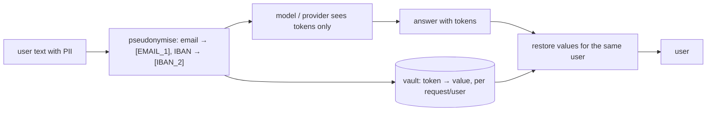

## Why it matters

Prompts are full of personal data: names, emails, account numbers, health details in support tickets. Every place that text flows — provider, logs, traces, caches, vector stores, fine-tuning sets — becomes a data-protection obligation.

## Concept



**Where personal data hides in AI systems:**

| Store | Control |
|---|---|
| Prompts sent to providers | Pseudonymise, minimise, DPA, region |
| Logs and traces | Content capture off, redaction, retention |
| Vector stores | Permission metadata, deletion on request |
| Conversation memory | Retention, user deletion, encryption |
| Caches | Scope per user/tenant, TTL |
| Fine-tuning data | Exclude or pseudonymise (models memorise) |

**Detection:** regexes plus checksums for structured identifiers; named-entity recognition (NER) models for names, addresses and free-form data; dictionaries for internal identifiers (customer numbers).

## Build it from scratch

<!-- code: lessons/p15-security-governance/src/main/java/dev/aieng/p15/PiiRedactor.java#redact -->

<!-- code: lessons/p15-security-governance/src/main/java/dev/aieng/p15/PiiRedactor.java#checksums -->

The test redacts an IBAN, a card number, an email (twice — same token both times) and a phone number, leaves an order number that fails Luhn untouched, and restores the original values in a model answer that refers to `[IBAN_2]` and `[EMAIL_1]`.

Two refinements the tests forced: phone detection originally matched any long digit run — including the order number — so it now requires an international `+` prefix or a national separator. **Precision matters**: over-redaction destroys the information the model needs.

## Now with the library

Wrap redaction as a Spring AI advisor so every call through a `ChatClient` is protected:

```java
class PiiAdvisor implements CallAdvisor {
    public ChatClientResponse adviseCall(ChatClientRequest req, CallAdvisorChain chain) {
        PiiRedactor.Redacted r = PiiRedactor.redact(req.prompt().getUserMessage().getText());
        ChatClientRequest redacted = req.mutate()
                .prompt(req.prompt().augmentUserMessage(r.text())).build();
        ChatClientResponse res = chain.nextCall(redacted);
        // restore r.vault() values in res's text before returning (omitted for brevity)
        return res;
    }
    public String getName() { return "pii"; }
    public int getOrder() { return Ordered.HIGHEST_PRECEDENCE; }
}
```

For names and addresses, add an NER model (e.g. an ONNX token-classification model via DJL) or a dedicated PII service.

## Production notes

- **Data processing agreements** with providers: retention, no training on your data, sub-processors, region.
- **DPIA** for high-risk processing; record the processing activity.
- **Right to erasure** must reach vector stores, memory and caches — design ids so you can find a person's data.
- **Never log the vault.**

## Exercises

1. **Easy** — Add detection for IPv4 addresses with validation of each octet.
2. **Medium** — Make `restore` safe against the model inventing tokens like `[EMAIL_9]` that are not in the vault (leave them visible and flag the answer).
3. **Hard** — Implement the `PiiAdvisor` fully, including restoration in the response, and test it with a fake model that echoes the tokens back.

## Common mistakes

- Redacting prompts but logging them unredacted elsewhere.
- Over-redaction that breaks the task.
- Personal data in fine-tuning sets.

## Further reading

- GDPR Articles 5, 6, 25, 35; EDPB guidance on AI models and data protection.
- Microsoft Presidio (concepts for PII detection pipelines).
