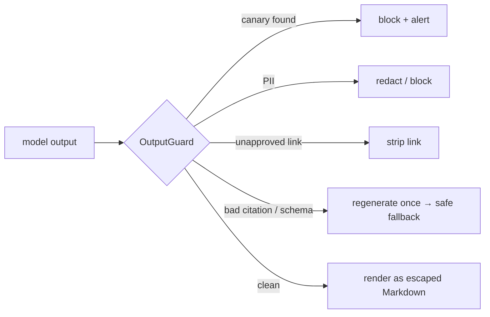

## Why it matters

Input defences fail sometimes. Output guards are the last deterministic checkpoint before text reaches a browser, a database or another system — and they catch the *results* of attacks you did not anticipate.

## Concept

| Check | Catches |
|---|---|
| Canary token | System prompt leakage |
| PII detector | Disclosure of personal data |
| Link/image allow-list | Exfiltration via rendered URLs, phishing |
| Citation range | Fabricated sources |
| Schema/business validation | Malformed or unsafe structured output (Phase 6) |
| Safe rendering | XSS via HTML in output |
| Content policy classifier | Harmful or off-brand content |

## Build it from scratch

<!-- code: lessons/p15-security-governance/src/main/java/dev/aieng/p15/OutputGuard.java#check -->

The test passes a clean answer with an approved intranet link and valid citation, then a malicious one containing the canary, a Markdown image to `evil.example` with a query string, an email address and an out-of-range citation `[3]` — all four violations are reported. Subdomains of approved domains are allowed.

## Now with the library

- Implement guards as a Spring AI **advisor** that inspects `ChatClientResponse` (for non-streaming) or the aggregated text (for streaming).
- The course app already applies safe rendering: `AiService.toHtml` uses CommonMark with `escapeHtml(true)` and `sanitizeUrls(true)`, and citation links are generated only for valid source numbers.
- Add `Content-Security-Policy` headers (`img-src 'self'`) to the UI so a missed image link still cannot load.

## Production notes

- **Decide actions per violation type** before launch (block, strip, regenerate, escalate).
- **Measure guard trigger rates;** sudden increases indicate attacks or model changes.
- **Streaming:** either guard aggregated output before showing it, or stream with a final guard that can retract and replace the message.

## Exercises

1. **Easy** — Add a check that rejects outputs longer than a configured maximum.
2. **Medium** — Implement a `GuardAdvisor` for `ChatClient` that regenerates once on citation violations, using a fake model in tests.
3. **Hard** — Add a CSP header to the course app via a Spring `OncePerRequestFilter` that allows only the CDNs it uses, and verify in a MockMvc test.

## Common mistakes

- Rendering model HTML directly.
- Guarding input but not output.
- No defined action when a guard fires.

## Further reading

- OWASP LLM05 Improper Output Handling.
- Johann Rehberger, research on data exfiltration via Markdown images in LLM apps (2023–2024).
