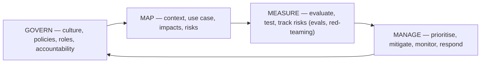

## Why it matters

Regulation and standards now shape what you may build and how you must build it. For an architect, governance is not paperwork: it translates into concrete engineering requirements — logging, documentation, human oversight, evaluation, transparency.

## Concept

### EU AI Act (risk-based)

| Tier | Examples | Engineering consequences |
|---|---|---|
| Prohibited | Social scoring, manipulative techniques, emotion recognition at work or school, untargeted facial-image scraping | Don't build |
| High-risk | Employment, credit scoring, access to essential services, education assessment, critical infrastructure (Annex III), safety components | Risk management, data governance, technical documentation, automatic logging, transparency, human oversight, accuracy/robustness/cybersecurity, conformity assessment |
| Limited risk (transparency) | Chatbots, AI-generated content | Disclose AI interaction; mark synthetic content |
| Minimal risk | Spam filters, internal productivity aids | Voluntary codes; AI literacy still applies |

General-purpose AI model providers have separate obligations; most enterprises are **deployers** (and sometimes providers of the systems they build on top).

### ISO/IEC 42001

An auditable **AI management system**: AI policy, roles, risk and impact assessment, controls (Annex A), lifecycle processes, monitoring and continual improvement — designed to sit next to ISO 27001.

### NIST AI Risk Management Framework

Plus the Generative AI Profile (NIST AI 600-1) listing GenAI-specific risks.

## Build it from scratch

A design-review triage helper — a structured first pass, **not legal advice**:

<!-- code: lessons/p15-security-governance/src/main/java/dev/aieng/p15/AiActTriage.java#triage -->

The tests classify emotion recognition at work as prohibited, CV screening as high-risk with human-oversight obligations, an intranet chatbot as limited-risk (transparency), and an internal productivity tool as minimal-risk.

## Mapping obligations to what you built

| Obligation | Engineering artefact in this course |
|---|---|
| Record-keeping / logging | Tamper-evident `AuditLog` (next lesson), observability (Phase 14) |
| Accuracy, robustness | Eval suites, CI gates (Phase 12), resilience (Phase 14) |
| Human oversight | Approvals, pending actions, staged autonomy (Phase 10) |
| Data governance | Dataset provenance, PII handling (Phases 9, 13, 15) |
| Transparency | Citations, AI disclosure in the UI, model/prompt versioning (Phases 7, 9) |
| Cybersecurity | OWASP LLM controls (this phase) |

## Production notes

- **Inventory first:** you cannot govern AI systems you don't know exist.
- **Proportionality:** a lightweight path for minimal-risk tools keeps teams on the approved path.
- **Track dates:** the AI Act's obligations phase in over several years — check the current timeline with legal for each system.

## Exercises

1. **Easy** — Triage five AI use cases from your organisation with `AiActTriage` and note which need legal review.
2. **Medium** — Write a one-page AI policy outline: scope, roles, approval workflow by tier, required artefacts.
3. **Hard** — Map ISO/IEC 42001 Annex A control areas onto your existing ISO 27001 controls and delivery process, identifying gaps.

## Common mistakes

- Treating governance as a one-time approval.
- Applying high-risk processes to every chatbot (or none to real high-risk systems).
- Forgetting the deployer's obligations when buying an AI product.

## Further reading

- Regulation (EU) 2024/1689 (AI Act), especially Articles 5, 6, 9–15, 26, 50 and Annex III.
- ISO/IEC 42001:2023.
- NIST AI RMF 1.0 and NIST AI 600-1 (Generative AI Profile).
