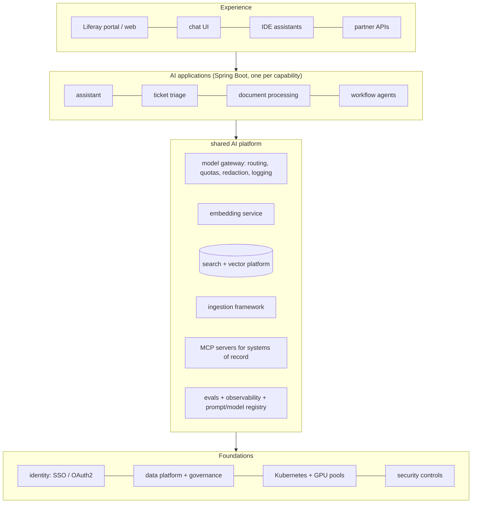

## Why it matters

Individual techniques — RAG, agents, guardrails — only deliver value inside a coherent architecture with clear ownership. As an architect you will be asked to draw it, defend it and evolve it.

## Concept: the layers



### Responsibilities

| Component | Owns |
|---|---|
| AI application | Prompts, retrieval config, tools selection, guardrails, evals for its domain |
| Model gateway | Provider credentials, routing, fallbacks, quotas, central logging policy |
| Search/vector platform | Indexes, hybrid search, permission metadata model |
| Ingestion framework | Connectors, chunking, embedding, change events, deletion |
| MCP servers | Narrow, permission-preserving access to systems of record |
| Eval/observability | Datasets, CI gates, GenAI telemetry, dashboards |

### Architecture Decision Records

```markdown
# ADR-007: Hybrid retrieval on OpenSearch for the intranet assistant
Status: Accepted (2026-10-14) — revisit if recall@5 < 0.85 or index > 50M chunks
Context: Liferay already indexes content in OpenSearch; queries contain product codes and prose.
Options: (1) pgvector only (2) OpenSearch BM25 + kNN with RRF (3) dedicated vector DB
Decision: (2) — one engine, existing operations, hybrid search native.
Consequences: + no new database; + identifier queries work; − HNSW memory on data nodes; − tied to OpenSearch versions.
```

Add a **revisit trigger** to every AI ADR — the landscape changes fast.

## Build it

The course application is itself a miniature of this architecture: a content ingestion step (`ContentLoader`), a search platform (`Bm25Index` + `SemanticIndex` + RRF), an AI application (`AiService` tutor with grounding and citations), safe output rendering, provider selection by configuration, Actuator for operations, and tests that act as quality gates (`TutorRetrievalEvalTest`). Read its code with this lesson's diagram in mind.

## Production notes

- **Platform vs product:** centralise what is truly common (gateway, search, evals); keep domain logic in product teams.
- **Paved roads:** make the compliant path the easiest path — templates, starters, shared libraries.
- **C4 diagrams:** context and container diagrams for every AI system, kept with the ADRs.

## Exercises

1. **Easy** — Draw the C4 container diagram of the course application.
2. **Medium** — Write two ADRs for the Liferay RAG assistant: vector store choice and model hosting choice, with revisit triggers.
3. **Hard** — Map your organisation's current systems onto the four planes and identify the three most valuable platform components to build first.

## Common mistakes

- Every team building its own gateway, ingestion and eval tooling.
- A central AI team that owns all prompts for all products (bottleneck).
- Decisions without recorded rationale.

## Further reading

- Michael Nygard, "Documenting Architecture Decisions" (2011).
- Simon Brown, The C4 model: <https://c4model.com/>
