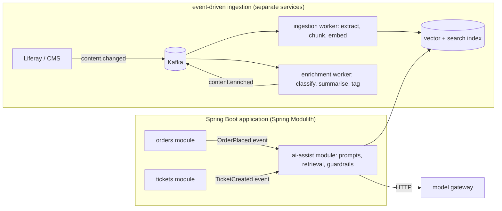

## Why it matters

AI features tempt teams into new microservices for everything. The right boundaries depend on scaling, runtime and ownership — and AI pipelines are naturally event-driven.

## Concept



| Put in a module (same app) | Extract to a service |
|---|---|
| Domain-coupled AI logic (triage of this app's tickets) | Workloads with different scaling (ingestion, batch enrichment) |
| Prompts and guardrails for this domain | GPU model servers, embedding services |
| Calls to hosted models via gateway | Python training/inference |
| | Shared platform pieces (gateway, MCP servers) |

**Event-driven patterns for AI:**

- **Ingestion on change:** `content.changed` → extract/chunk/embed → upsert; `content.deleted` → delete chunks.
- **Asynchronous enrichment:** classify, summarise or tag new records without blocking users; write results back via events.
- **Outbox pattern:** publish events transactionally with the domain change (Spring Modulith's event publication registry or a transactional outbox).
- **Replay:** re-embed everything after a model change by replaying events or a backfill topic.

## Build it

Spring Modulith events between modules (sketch):

```java
// tickets module
@Transactional
public Ticket create(NewTicket cmd) {
    Ticket t = repository.save(Ticket.from(cmd));
    events.publishEvent(new TicketCreated(t.id(), t.text()));   // persisted by the event publication registry
    return t;
}

// ai-assist module
@ApplicationModuleListener                                       // async, after commit, retried if it fails
void on(TicketCreated e) {
    var triage = ticketTriage.triage(e.text());                  // Phase 6 TicketTriage
    events.publishEvent(new TicketTriaged(e.id(), triage.category(), triage.priority()));
}
```

The same `TicketTriaged` event can later be externalised to Kafka (Spring Modulith supports event externalisation) if triage moves to its own service.

## Production notes

- **Idempotent consumers** (deterministic chunk ids, upserts) — events are delivered at least once.
- **Dead-letter topics** for documents that fail extraction or embedding; alert on growth.
- **Back-pressure on providers:** consumer concurrency sized to embedding rate limits.
- **Ordering:** key Kafka messages by document id so updates and deletes for one document stay in order.

## Exercises

1. **Easy** — List the modules of an application you know and mark which would host AI logic.
2. **Medium** — Implement `TicketCreated` → triage with Spring application events and a fake `ChatModel`, using `@TransactionalEventListener`.
3. **Hard** — Design the Kafka topics, keys, retention and DLQ strategy for ingesting Liferay content changes into a vector index, including replay for re-embedding.

## Common mistakes

- Synchronous embedding inside the publish transaction.
- Non-idempotent consumers creating duplicate chunks.
- Microservices for every prompt.

## Further reading

- Spring Modulith reference documentation.
- Chris Richardson, "Transactional outbox" pattern.
