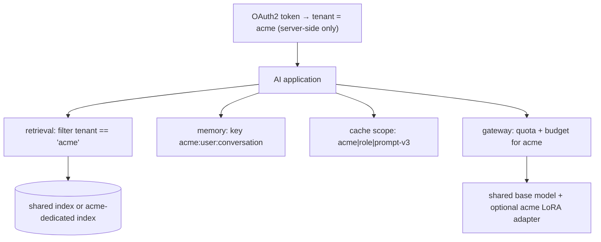

## Why it matters

Liferay DXP is built for multi-site, multi-tenant (virtual instance) deployments, and many enterprise AI products are SaaS. A single cross-tenant leak — one customer's document in another's answer — can end a product.

## Concept

| Layer | Shared (default) | Dedicated (premium / regulated) |
|---|---|---|
| Vector/search index | One index, tenant filter | Index or collection per tenant |
| Model | Shared endpoint, per-tenant quotas | Dedicated deployment / region |
| Customisation | Prompt configuration per tenant | Per-tenant LoRA adapter |
| Keys | Platform key | Tenant-provided key (BYOK) |

## Build it

Tenant isolation patterns you have already implemented:

| Pattern | Where |
|---|---|
| Mandatory metadata filter in retrieval | `TenantSearch` (Phase 8, lesson 5) |
| Per-user/tenant memory | `Memory.LongTerm` (Phase 10), `ConversationService` ids (Phase 6) |
| Scoped semantic cache | `SemanticCache` scope key (Phase 14) |
| Per-tenant token budgets | `TokenBudget` (Phase 14) |

The architectural rule tying them together: **tenant id comes only from the server-side security context**, flows explicitly through every layer, and every store's key or filter includes it.

## Production notes

- **Cross-tenant tests in CI:** seed two tenants with conflicting content and assert no leakage across retrieval, memory and caches.
- **Per-tenant deletion** must be complete — indexes, memories, caches, logs, adapters.
- **Noisy neighbours:** per-tenant quotas and concurrency limits protect shared capacity.
- **Liferay virtual instances** map naturally to tenants; sites to sub-scopes within a tenant.

## Exercises

1. **Easy** — List every store in the course app and say how you would add a tenant dimension.
2. **Medium** — Write a JUnit test template that seeds two tenants and runs a list of queries against a `TenantSearch`, failing on any cross-tenant hit.
3. **Hard** — Design per-tenant LoRA serving: how adapters are trained, stored, versioned and selected per request, and how you evaluate each tenant's adapter.

## Common mistakes

- Tenant id as a request parameter.
- Forgetting caches and logs.
- Global few-shot examples drawn from one tenant's data.

## Further reading

- AWS, "SaaS tenant isolation strategies" whitepaper.
- Liferay DXP virtual instances and sites documentation.
