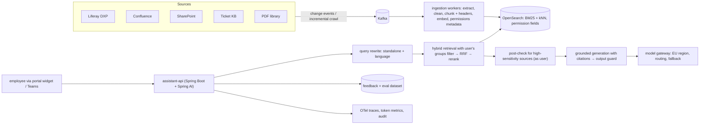

## Problem

A 40,000-employee company has knowledge spread across **Liferay DXP** (intranet), **Confluence**, **SharePoint**, a ticketing system's knowledge base and PDF policy libraries — about **2 million documents** in English and German. Employees waste time searching. Leadership wants an assistant that answers questions with sources, respects existing permissions, and costs less than €15,000/month.

## Requirements

| Functional | Non-functional |
|---|---|
| Answer questions with citations to source pages | p95 time-to-first-token < 3 s; full answer < 10 s |
| Respect each source's permissions | Zero cross-permission leakage (red-team verified) |
| English and German | Faithfulness ≥ 0.9; retrieval recall@8 ≥ 0.85 on eval set |
| "I don't know" when sources don't cover it | Correct refusal ≥ 0.9 on unanswerable set |
| Feedback (thumbs, comments) | Index freshness < 15 minutes for changed content |
| | Cost ≤ €15k/month; data stays in EU region |

## Capacity estimates

- Users: 40,000 × 10% daily active × 4 questions ≈ **16,000 questions/day**; peak ≈ 3× average ≈ **0.6 QPS** average, plan for **5 QPS** peaks.
- Corpus: 2M documents × ~6 chunks ≈ **12M chunks**; 768-dim float32 ≈ 12M × 3 KB ≈ **37 GB** of vectors (≈ 9 GB as int8).
- Tokens per question: ~2,500 input (system + 8 chunks + question) + ~300 output. Daily: 40M input + 5M output tokens. At illustrative mid-tier prices this is a few hundred euros per day — budget fits with routing and caching (Phase 6 cost model).

## Architecture

## Key decisions

| Decision | Choice | Why (and revisit trigger) |
|---|---|---|
| RAG vs fine-tuning | RAG | Changing, permissioned, citable knowledge (Phase 13 L1) |
| Search platform | OpenSearch hybrid | Liferay already uses it; identifiers + prose (Phase 8 L4) |
| Permissions | Group metadata pre-filter + source re-check for HR/legal sources | Defence in depth (Phase 9 L6) |
| Models | Mid-size hosted model in EU region via gateway; small model for query rewriting | Cost and residency; revisit if self-hosting gets cheaper |
| Chunking | Heading-aware with contextual headers, ~400 tokens | Phase 9 L2; validated by recall eval |
| Languages | Multilingual embedding model; answer in question language | Single index for EN/DE |

## Failure modes and mitigations

| Failure | Mitigation |
|---|---|
| Permission drift (user removed from group) | Group sync from IdP every few minutes; source re-check for sensitive sources |
| Stale or deleted content still answered | Delete events, nightly reconciliation, freshness metric |
| Provider outage | Gateway fallback to second model; degraded "sources only" mode |
| Low-quality sources | Source quality scoring, boosting authoritative spaces |
| Prompt injection in wiki pages | Sanitising, no write tools, output guard (Phase 15) |

## Rollout plan

1. **Pilot** (6 weeks): Liferay intranet + ticket KB, 500 users from support and HR; collect 300 real questions into the eval set.
2. **Gate:** recall@8 ≥ 0.85, faithfulness ≥ 0.9, zero leakage in red-team.
3. **Expand** sources one at a time, each with its own connector tests and eval subset.
4. **General availability** with feedback loop, weekly quality review and monthly cost review.

## Exercises

1. **Easy** — Recompute token cost per month with current prices for two candidate models.
2. **Medium** — Write the ADR for the permission strategy, including what happens when the source re-check times out.
3. **Hard** — Design the eval dataset: categories, sizes, how unanswerable and permission cases are created, and how production feedback flows into it.

## Further reading

- Phases 8, 9, 12, 14 and 15 of this course — every box in the diagram maps to a lesson.
