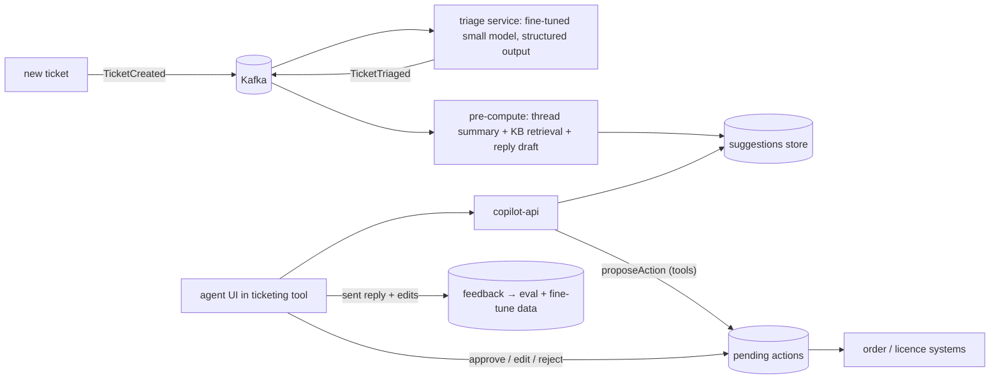

## Problem

A software vendor's support team (120 agents, 6,000 tickets/day, 4 languages) wants to cut handling time by 30% without lowering satisfaction. Tickets arrive by email and portal; agents use a ticketing system, a knowledge base in Liferay and an order/licence system.

## Requirements

| Functional | Non-functional |
|---|---|
| Auto-triage category, priority, product | Triage accuracy ≥ 90% on top categories |
| Draft grounded replies with KB citations | Draft ready < 10 s after ticket opens |
| Propose actions (licence reset, refund) | Every action approved by an agent; refunds > €100 by a supervisor |
| Summarise long threads | Full audit trail of AI suggestions and decisions |
| Learn from agent edits | Cost < €0.05 per ticket |

## Architecture

## Design highlights

| Element | Decision | Course link |
|---|---|---|
| Triage | Distilled fine-tuned 1–3B model; frontier model fallback on low confidence | Phase 13 L6, Phase 14 L1 |
| Drafts | RAG over KB with citations; tone per customer tier | Phase 9 |
| Pre-computation | Drafts computed on `TicketTriaged`, so they are ready when the agent opens the ticket | Phase 16 L2 |
| Actions | Tools create pending actions; approval thresholds in code | Phase 10 L3/L6 |
| Learning loop | Agent edits → eval dataset; periodic re-distillation | Phases 12, 13 |
| Languages | Answer in ticket language; KB retrieval with translated query when needed | Phase 9 L5 |

## Cost sketch

6,000 tickets × (triage ~600 tokens on a small self-hosted model + summary/draft ~4,000 input + 400 output on a mid-tier hosted model) ≈ 24M input + 2.4M output hosted tokens/day — tens of euros per day at mid-tier prices, inside the €0.05/ticket target. Routing hard tickets (≈10%) to a stronger model adds little.

## Risks

| Risk | Mitigation |
|---|---|
| Agents over-trust drafts | UI shows sources and confidence; QA sampling |
| Wrong action proposed | Approval required; actions validated against order data |
| Injection via customer emails | Emails treated as untrusted data; action tools never triggered by email content alone |
| Model drift after KB changes | Nightly evals; freshness monitoring |

## Exercises

1. **Easy** — Define the `TicketTriage` record and validation rules for this domain (Phase 6 L5).
2. **Medium** — Design the agent UI states for a suggestion (pending, accepted, edited, rejected) and what is logged for each.
3. **Hard** — Plan an A/B experiment across agent teams: hypothesis, metrics, duration, guardrails and decision rule.

## Further reading

- Brynjolfsson, Li & Raymond, "Generative AI at Work" (2023) — field study of an AI assistant for support agents.
