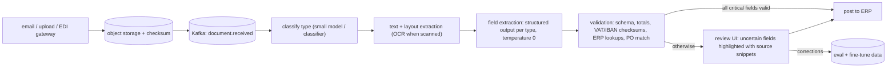

## Problem

A shared-services centre receives **50,000 documents per day** — supplier invoices (70%), delivery notes and contracts — as PDFs and scans in six languages. Manual entry costs minutes per document. Goal: process at least 60% straight through with ≥ 99% accuracy on critical fields, and make review fast for the rest.

## Architecture

## Design highlights

| Concern | Approach | Course link |
|---|---|---|
| Extraction | `entity(Invoice.class)` with enums and nested `LineItem` lists | Phase 6 L5 |
| Validation | Deterministic business rules; IBAN mod-97, totals, ERP master data | Phase 15 L3 |
| Throughput | Spring Batch / Kafka consumers sized to provider TPM; batch APIs for non-urgent docs | Phase 14 L3/L6 |
| Cost | Small model for classification; larger model only for complex contracts | Phase 14 L1 |
| Learning | Reviewer corrections → eval set → fine-tuned extractor | Phases 12, 13 |
| Audit | Every posted value linked to document, page, model and prompt version | Phase 15 L6 |

## Capacity

50,000 docs/day ≈ 0.6 docs/second average; with ~3,000 input and 500 output tokens per document, 150M input + 25M output tokens/day. Processing over 16 hours needs ~2,600 input tokens/second — within typical enterprise rate limits but requires a quota increase and back-pressure.

## Risks

| Risk | Mitigation |
|---|---|
| Plausible but wrong numbers | Cross-field validation, ERP matching, no posting on failed checks |
| Poor scans | OCR confidence thresholds → review |
| Injection in documents ("approve this invoice") | Documents are data; extraction has no tools; posting rules are code |
| Vendor format drift | Per-supplier accuracy monitoring and alerts |

## Exercises

1. **Easy** — Write the `Invoice` and `LineItem` records with enums and validation annotations.
2. **Medium** — Implement the totals and IBAN checks as a validator and test with five crafted invoices.
3. **Hard** — Design the review UI data model and the metric that decides when a supplier's documents can move to straight-through processing.

## Further reading

- Spring Batch reference documentation (chunk-oriented processing, skip and retry).
