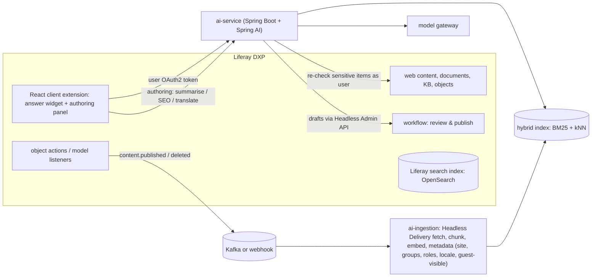

## Problem

A manufacturer runs **Liferay DXP** with 25 sites: a public website (anonymous), a partner portal (authenticated partners, per-partner content) and an employee intranet. Search is keyword-based; users struggle to find answers across product documentation, FAQs and knowledge-base articles in 8 languages. Editors want help with summaries, SEO metadata and translations.

## Goals

- Semantic and hybrid search with **generated answers and citations** on each site.
- **No leakage** across sites, partner accounts or visibility levels — including anonymous vs authenticated.
- **AI-assisted authoring** inside existing editorial workflows.
- Measurable search success (fewer zero-result and reformulated searches, higher click-through).

## Architecture

## Key design points

| Topic | Decision | Course link |
|---|---|---|
| Integration | Client extensions (no core customisation); AI service outside the portal | Phase 9 L6 |
| Identity | Liferay OAuth2 / SSO token passed to the AI service; anonymous requests limited to guest-viewable content | Phase 11 L4 |
| Permissions | Site + group + visibility metadata pre-filter; as-user re-check for partner-restricted content | Phases 8 L5, 9 L6 |
| Hybrid search | OpenSearch BM25 + kNN with RRF; product codes favour BM25 | Phase 8 L4 |
| Multilingual | Multilingual embeddings; answer in page locale; locale filter with fallback to default language | Phase 9 L5 |
| Authoring | AI suggestions saved as drafts; Liferay workflow approval; "AI-assisted" flag | Phase 15 L5 |
| Agents/MCP | Optional Liferay MCP server for internal tools (IDE, chat apps) | Phase 11 |

## Evaluation and analytics

- Offline: per-site eval sets (answerable, unanswerable, permission traps), recall@k, faithfulness, refusal accuracy.
- Online: search success rate, zero-result rate, answer click-through to cited pages, thumbs, deflected support tickets (partner portal).
- Editors: acceptance rate of AI drafts, edit distance, time to publish.

## Risks

| Risk | Mitigation |
|---|---|
| Partner A sees partner B's pricing | Group-level filters + as-user checks; cross-partner red-team tests |
| Answers from outdated documentation | Version/expiry metadata; prefer latest product version; freshness monitoring |
| Brand and legal risk on public site | Conservative prompts, citations required, output guard, disclosure, refusal for off-topic |
| Upgrade friction | No core changes; client extensions and headless APIs only |

## Exercises

1. **Easy** — Define the metadata schema for each indexed chunk in this design.
2. **Medium** — Sketch the React client extension's API contract with the AI service (request, response with citations, error and fallback states).
3. **Hard** — Design the per-site eval set and red-team plan for the partner portal, including how test partner accounts are provisioned.

## Further reading

- Liferay client extensions, Headless Delivery and Headless Admin API documentation (learn.liferay.com).
- Phases 8, 9, 11 and 15 of this course.
