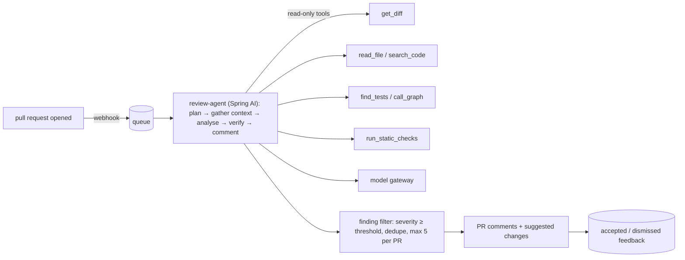

## Problem

A platform team maintains a 2-million-line Spring monorepo with 150 contributors and 300 PRs per week. Reviews are slow and inconsistent. They want an agent that leaves a small number of **high-value** review comments within 10 minutes of a PR opening — bugs, security issues, missing tests — and nothing else.

## Architecture

## Design highlights

| Element | Decision | Course link |
|---|---|---|
| Agent loop | Bounded steps, token budget, read-only tools | Phase 10 L2/L6 |
| Context | Diff + targeted file reads + related tests, not whole repo | Phase 7 L4 |
| Output | Structured findings (`file`, `line`, `severity`, `category`, `explanation`, `suggestion`) | Phase 6 L5 |
| Precision control | Severity threshold, max comments per PR, category kill-switches from feedback | Phase 12 |
| Verification | Suggested changes compiled/tests run in a sandbox before posting where feasible | Phase 15 |
| Security | Repo token scoped to read + comment; no merge or push rights; secrets never in prompts | Phase 15 |

## Evaluation

- **Offline benchmark:** 200 historical PRs with known issues + 100 clean PRs; measure precision, recall, comments per PR.
- **Online:** accepted vs dismissed comments per category; time-to-merge; developer survey.
- **Gate:** precision ≥ 70% on benchmark before enabling in a repository; per-category disablement below 50% acceptance.

## Risks

| Risk | Mitigation |
|---|---|
| Noise erodes trust | Strict thresholds, comment caps, feedback-driven suppression |
| Injection via code comments or PR descriptions | Treat repo text as data; tools read-only; no external network |
| Leaking proprietary code to providers | Approved provider with DPA, region, no training; or self-hosted model |
| Cost spikes on huge PRs | Size limits; summarise-only mode for large diffs |

## Exercises

1. **Easy** — Define the `Finding` record and validation rules.
2. **Medium** — Write the system prompt with project guidelines and examples of good and bad comments.
3. **Hard** — Build a small version with Phase 10's `ReactAgent`: tools `get_diff` and `read_file` over a local git checkout, a scripted fake model in tests, and a finding filter.

## Further reading

- Phase 10 (agents), Phase 12 (evals), Phase 15 (security) of this course.
