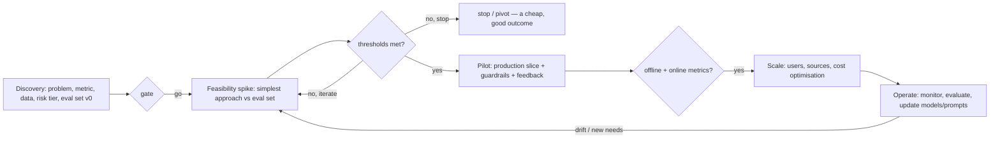

## Why it matters

Most failed AI initiatives fail at management level: no success metric, no evaluation data, a demo mistaken for a product, or a plan that assumes the hardest part is certain. Your PMP and PSM toolkits apply — once adapted to uncertainty.

## Concept

| AI-specific uncertainty | Management response |
|---|---|
| Can the model reach the quality bar? | Feasibility spike with eval set before committing |
| Is the data available, clean, allowed? | Data assessment in discovery; legal early |
| Will users trust and adopt it? | Pilot with feedback, staged autonomy |
| Will costs scale acceptably? | Cost model from day one (Phase 6) |
| Will the model/provider change under us? | Abstractions, evals, ADR revisit triggers |

## Mapping to what you know

| PMP / Scrum | AI adaptation |
|---|---|
| Business case | ROI model with quality as an explicit input (lesson 4) |
| Phase gates | Go/no-go on eval thresholds and cost per task |
| Scope statement | Success metric + eval set + out-of-scope categories |
| Risk register | Adds model, data, safety and regulatory risks (lesson 5) |
| Definition of Done | Includes eval thresholds and safety tests (lesson 3) |
| Sprint goal | Often "move metric X from A to B", not "build feature Y" |
| Stakeholder management | Expectation setting about probabilistic behaviour |

## Build it

A one-page **AI initiative canvas** to complete in discovery:

| Field | Example (support triage) |
|---|---|
| Problem / user | Agents spend 2 min classifying each ticket |
| Success metric | Triage accuracy ≥ 90%; handling time −15% |
| Data | 200k labelled historical tickets; contains PII → pseudonymise |
| Approach to test first | Prompted model with few-shot + structured output |
| Eval set | 300 tickets, stratified by category, 50 edge cases |
| Risk tier | Limited (internal, human in the loop) |
| Cost guardrail | ≤ €0.01 per ticket |
| Kill criteria | < 80% accuracy after two iterations of the spike |

## Production notes

- **Celebrate cheap "no" decisions** — a stopped spike after two weeks is a success of the process.
- **Demos are not evidence;** eval results are.
- **Plan operations from the start** — an AI feature needs ongoing evaluation and updates like a living service.

## Exercises

1. **Easy** — Fill in the canvas for an AI idea from your organisation.
2. **Medium** — Define the exit criteria for each gate of that initiative.
3. **Hard** — Write a stage-gate review template for your PMO that includes eval results, cost model, risk tier and governance status.

## Common mistakes

- Committing a fixed scope and date before feasibility is known.
- No kill criteria.
- Treating the pilot as the finish line.

## Further reading

- CRISP-DM process model (and its limits for LLM products).
- Google, "People + AI Guidebook".
