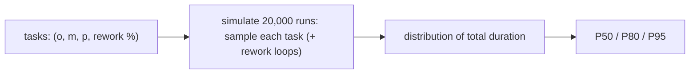

## Why it matters

AI tasks have skewed durations: most experiments take about as long as expected, some take far longer because the first approach misses the quality bar. Single-point estimates — even PERT means — hide that tail. Percentile forecasts don't.

## Concept

**PERT** (three-point) mean: $\mu = \dfrac{o + 4m + p}{6}$ — useful, but summing means ignores dependencies, skew compounding and rework loops.

**Monte Carlo:** model each task as a distribution (here triangular from optimistic, most likely and pessimistic), add a probability of rework (an experiment missing its eval gate), simulate the plan 20,000 times, and read percentiles.



## Build it from scratch

<!-- code: lessons/p17-delivery-leadership/src/main/java/dev/aieng/p17/MonteCarloEstimate.java#simulate -->

The triangular sampler uses inverse-CDF sampling — the same technique LLMs use to pick tokens (Phase 1, lesson 4).

`MonteCarloEstimate.main` for a five-task RAG initiative (discovery, ingestion, the RAG experiment with a 40% chance of missing recall targets, guardrails, pilot):

```text
PERT sum 51 days | P50 63 | P80 72 | P95 84
```

The PERT total (51 days) is below even the median. Committing to it means committing to a date you will likely miss. The test `reworkRiskPushesTheForecastBeyondPert` proves the point: PERT is identical with or without rework risk; the simulation's P80 moves by more than three days.

## Now with the tools

- Spreadsheets can do this (random sampling + data tables), but code is versionable and testable.
- Jira/Azure Boards throughput data supports Monte Carlo forecasting from *historical* velocity (number of items finished per week) instead of estimates — useful once the team has history.
- Present forecasts as fan charts or percentile tables, updated every sprint.

## Production notes

- **Estimate experiments as time-boxes** with gates, not as tasks with certain outcomes.
- **Re-forecast every sprint** with actuals; publish the trend of P80 over time.
- **Name the drivers:** "The RAG recall experiment is 60% of the variance" focuses risk reduction.

## Exercises

1. **Easy** — Change the RAG experiment's rework probability to 0.1 and 0.7; record P80.
2. **Medium** — Add task dependencies that run in parallel (the plan finishes when the longest branch finishes) and compare with the sequential model.
3. **Hard** — Replace task estimates with historical throughput: simulate weeks to finish 40 backlog items by sampling weekly throughput from your team's last 15 sprints.

## Common mistakes

- Treating P50 as a commitment.
- Ignoring rework loops for experiments.
- Never updating the forecast.

## Further reading

- Daniel Vacanti, *When Will It Be Done?* (2020).
- PMI, *PMBOK Guide* — quantitative risk analysis (Monte Carlo).
