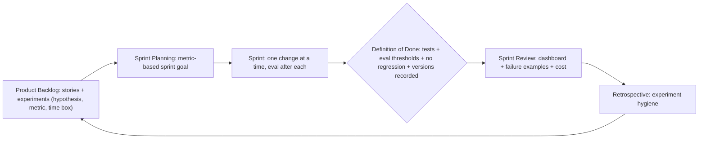

## Why it matters

Scrum is built on empiricism, which suits AI well — but only if the "inspect" step uses real evidence. That means evals in the Definition of Done, experiments in the backlog, and metric dashboards in the Review.

## Concept



### Experiment backlog item template

```text
Hypothesis: Adding a cross-encoder reranker raises nDCG@5 on the support eval set by ≥ 0.05
            without p95 latency above 4 s.
Time box:   3 days
Measure:    nDCG@5, p95 latency, cost per query (eval run on fixed dataset v12)
Decision:   adopt if both thresholds met; otherwise record result and drop
```

### Definition of Done for AI increments

- Unit tests with fake models pass (deterministic logic).
- Eval suite: thresholds met, no regression beyond tolerance vs production baseline (Phase 12).
- Safety/red-team regression cases pass (Phase 15).
- Prompt, model, retrieval settings versioned; ADR updated if a decision changed.
- Observability: token, latency and quality metrics emitted; dashboards updated.
- Cost per request within budget.

### Team roles

| Role | Contribution |
|---|---|
| Product Owner | Success metrics, thresholds, prioritising experiments vs features |
| AI/software engineers | Pipelines, prompts, retrieval, evals, integration |
| Domain experts | Labelling, eval cases, failure review — part of the team, not a ticket queue |
| Platform/SRE | Gateway, observability, capacity |
| Security/compliance | Risk tier, red-teaming, governance artefacts |

## Build it

Wire the Definition of Done into CI: the Phase 12 `EvalRunner` gate and the course app's `TutorRetrievalEvalTest` are examples of DoD items that fail the build automatically. A DoD that a pipeline enforces is a DoD that holds.

## Production notes

- **Review failures, not just averages,** in Sprint Reviews — show five bad outputs and what was learned.
- **Protect the eval set:** changing it is a backlog item with review, not a casual edit.
- **Limit WIP on experiments** — parallel experiments on the same metric confound results.

## Exercises

1. **Easy** — Rewrite three vague AI backlog items as hypotheses with time boxes.
2. **Medium** — Draft your team's AI Definition of Done and mark which items CI can enforce.
3. **Hard** — Design a Sprint Review dashboard for an AI feature (metrics, failure gallery, cost) and the data needed to populate it.

## Common mistakes

- Demo-driven reviews.
- Stories with "make it smarter" acceptance criteria.
- Domain experts outside the team.

## Further reading

- The Scrum Guide (2020) — empiricism and the Definition of Done.
- Hamel Husain, "A Field Guide to Rapidly Improving AI Products" (2025).
