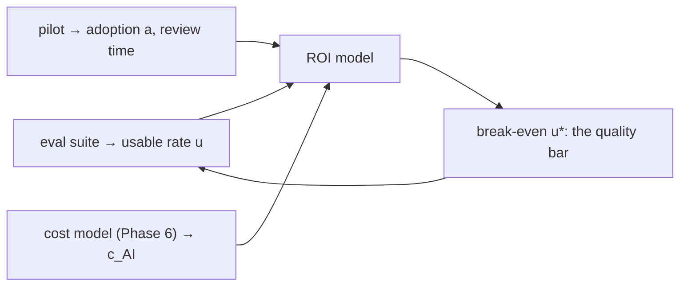

## Why it matters

AI business cases are often either wildly optimistic ("saves 50% of everyone's time") or impossible to evaluate. A small explicit model — where every assumption is visible — makes the case debatable, testable and linkable to engineering targets.

## Concept

$$\text{net benefit} = N \cdot a \cdot \left(u \cdot t_{\text{saved}} - t_{\text{review}}\right) \cdot \frac{c_{\text{hour}}}{60} - \left(N \cdot a \cdot c_{\text{AI}} + C_{\text{platform}}\right)$$

with $N$ tasks/month, adoption $a$, usable rate $u$ (from evals and the pilot), minutes saved $t_{\text{saved}}$, review minutes $t_{\text{review}}$, loaded hourly cost $c_{\text{hour}}$, AI cost per task $c_{\text{AI}}$ and fixed platform cost $C_{\text{platform}}$. Payback = build cost / net monthly benefit.



## Build it from scratch

<!-- code: lessons/p17-delivery-leadership/src/main/java/dev/aieng/p17/BusinessCase.java#roi -->

`BusinessCase.main` with illustrative support assumptions (180,000 tickets/month, 70% adoption, 75% usable outputs, 4 minutes saved, 0.5 minutes review, €45/hour):

```text
benefit €236,250/month, cost €11,040/month, net €225,210/month, payback 1.1 months
break-even requires >= 15% usable outputs
```

The interesting number is the last one: below 15% usable outputs the feature loses money. That is a concrete quality target for the eval suite, agreed with finance before the build. The test checks the arithmetic by hand and shows a case where a 10% usable rate never pays back.

Treat optimistic outputs like this one sceptically: run sensitivity analysis on adoption, usable rate and review time — the three assumptions most often wrong.

## Build vs buy

| Factor | Buy favours | Build favours |
|---|---|---|
| Requirements | Standard use cases | Complex permissions, domain workflows |
| Time to value | Weeks | Months |
| Data terms / residency | Acceptable vendor terms | Strict internal requirements |
| Integration | Existing connectors | Deep integration (Liferay, ERP, custom systems) |
| Differentiation | Commodity | Competitive advantage |
| Run cost | Per-seat licences | Per-token + platform team |
| Exit | Lock-in risk | Own the stack |

## Production notes

- **Measure the inputs in the pilot** — adoption, usable rate and review time — and update the case.
- **Report actuals monthly** against the case; it builds credibility for the next initiative.
- **Include the platform team** in run costs (evals, monitoring, model updates).

## Exercises

1. **Easy** — Run `BusinessCase.main` with adoption 0.3 and review time 2 minutes. What happens?
2. **Medium** — Add a sensitivity table: net benefit for usable rate 0.4–0.9 and adoption 0.2–0.8.
3. **Hard** — Build a build-vs-buy scorecard for an intranet assistant with weights agreed with stakeholders, and fill it for one vendor and the Phase 16 design.

## Common mistakes

- Ignoring review time and adoption.
- Benchmarks as a proxy for your usable rate.
- One-off build cost without run cost.

## Further reading

- Phase 6 lesson 1 (cost per request) and Phase 12 (evals) of this course.
