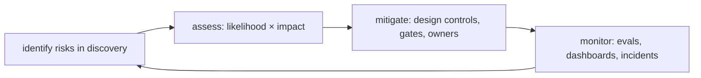
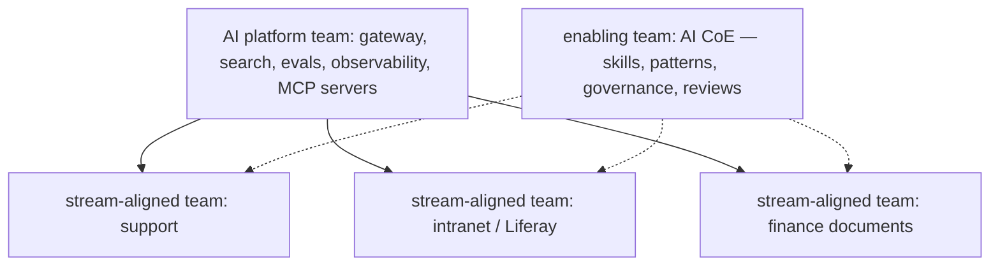

## Why it matters

Technology rarely sinks AI programmes on its own; unmanaged risk, mismatched expectations and the wrong team structure do. This is where your PMP and Scrum experience adds the most value to AI engineering.

## Concept: AI risk register (additions to a classic register)

| Risk | Likelihood driver | Mitigation | Owner |
|---|---|---|---|
| Quality below threshold | Novel task, poor data | Feasibility spike, kill criteria | Product Owner |
| Silent model change by provider | Unpinned model aliases | Pin versions, scheduled evals, alerts | Tech lead |
| Data leakage across permissions | Complex permission models | Filters + source checks + red-team | Security |
| Regulatory non-compliance | High-risk use case | AI Act triage, legal review, documentation | Compliance |
| Vendor lock-in / price change | Single provider | Abstraction (Spring AI), second provider evaluated | Architect |
| Cost overrun | Usage growth, long prompts | Budgets, routing, caching, dashboards | Product + FinOps |
| Low adoption | Poor UX, distrust | Pilot, training, feedback loop | Product Owner |
| Workforce concerns | Automation fears | Early communication, works council, reskilling | Sponsor |

## Stakeholder communication

- **Show, don't promise:** real outputs on real data, including failures.
- **Rates with examples** instead of adjectives.
- **Explain the safety net:** citations, human approval, feedback, monitoring.
- **Make trade-offs explicit:** quality vs cost vs latency vs autonomy.

## Vendor risk

Assess providers like any critical supplier: data processing terms (retention, training on your data, sub-processors), regions, security certifications, SLAs, model deprecation policies, price change terms, and exit options. Keep a second provider evaluated through the same eval suite.

## Team structure

Skills to grow in product teams: evaluation design, prompt and context engineering, retrieval, AI security — and domain experts embedded for labelling and review.

## Build it

Use this course's artefacts as your team kit: lesson templates for onboarding, the eval runner and CI gates as DoD enforcement, the AI Act triage in design reviews, the cost model and business case in planning, and the Monte Carlo forecaster in steering committees.

## Production notes

- **Review the risk register at every gate,** not only at kickoff.
- **Post-incident reviews** for AI failures, blameless and data-driven, feeding evals and guardrails.
- **Measure capability growth:** number of teams shipping AI features on the paved road.

## Exercises

1. **Easy** — Add five AI-specific risks to a register for one of your projects, with owners.
2. **Medium** — Write a one-page stakeholder update for an AI pilot: quality with examples, cost, adoption, risks, next steps.
3. **Hard** — Design the team topology and first-year roadmap for an AI platform team in your organisation, including what the paved road offers in quarter 1.

## Common mistakes

- Risk registers without AI-specific risks.
- Over-promising after a great demo.
- A central AI team as a delivery bottleneck.

## Further reading

- Skelton & Pais, *Team Topologies* (2019).
- PMI, *PMBOK Guide* — risk and stakeholder performance domains.
