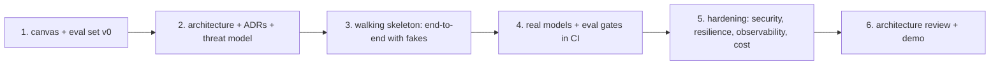

## Why it matters

Capstones turn eighteen phases of separate skills into one system you can explain, defend and demo — the strongest preparation for AI architect interviews and real projects.

## The method



### Repository layout (per capstone)

```text
capstone-x/
  pom.xml                      Spring Boot 4.x, Spring AI 2.x
  src/main/java/...            modules: ingestion, retrieval, assistant, tools, web
  src/main/resources/prompts/  versioned prompts (Phase 7)
  src/test/java/...            unit tests with fake models (Phase 6)
  src/test/resources/evals/    eval datasets + baseline.json (Phase 12)
  docs/adr/                    ADRs with revisit triggers (Phase 16)
  docs/threat-model.md         OWASP LLM table (Phase 15)
  docs/cost-model.md           cost per request and per month (Phases 6, 17)
  docker-compose.yml           Ollama, pgvector / OpenSearch, app (Phase 14)
```

Reuse the course code freely: `Chunker`, `TenantSearch`, `ToolRegistry`, `EvalRunner`, `PiiRedactor`, `OutputGuard`, `TokenBudget`, `ModelRouter`, `AuditLog`, `LiferayContent`.

### Evidence pack

| Artefact | Source phase |
|---|---|
| Canvas: problem, metric, data, risk tier, kill criteria | 17 |
| Architecture diagram (C4 container) + 3–5 ADRs | 16 |
| Eval report: metrics with CIs, per-category scores, failure gallery | 12 |
| Threat model + red-team results | 15 |
| Cost model + measured cost per request | 6, 14, 17 |
| Runbook: deployment, monitoring, incident playbook | 14 |

### Review rubric

| Dimension | Strong evidence |
|---|---|
| Problem framing | Metric tied to a user/business outcome; kill criteria |
| Architecture | Clear boundaries; decisions recorded with alternatives |
| Quality | Eval gates in CI; honest failure analysis |
| Safety & security | Permissions tested; injection and leakage red-teamed |
| Operability | Resilience, budgets, observability, runbook |
| Cost | Measured, attributed, optimised with evidence |
| Communication | 10-minute demo + review that a CTO and an engineer both follow |

## Exercises

1. **Easy** — Pick the capstone closest to your work and write its canvas.
2. **Medium** — Create the repository skeleton above with a walking skeleton that answers "hello" through a fake `ChatModel` and passes one eval case in CI.
3. **Hard** — Schedule the six steps with the Monte Carlo forecaster from Phase 17 and track actuals.
