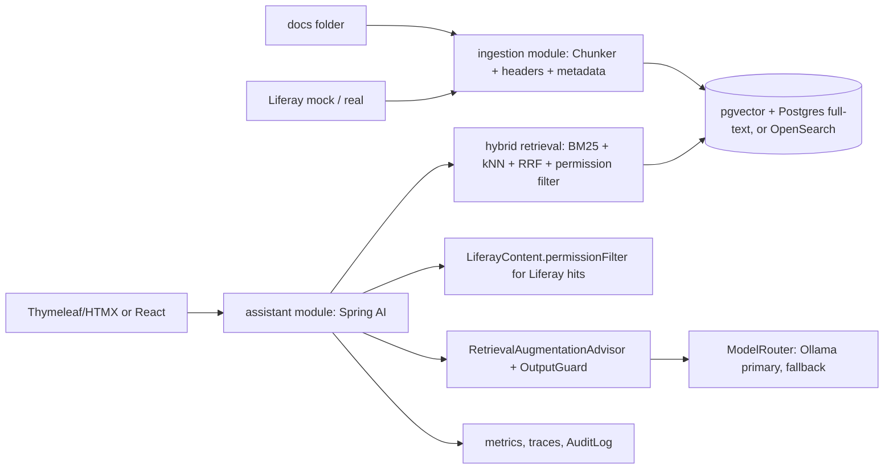

## Brief

Build an assistant that answers employee questions from **two sources** — a Markdown documentation folder and a (mocked or real) Liferay site via Headless Delivery — with citations, refusal when unsupported, and strict per-user permissions.

## Requirements

| Functional | Acceptance criteria |
|---|---|
| Ingest both sources incrementally | Changed docs re-indexed < 5 min; deletes propagate |
| Hybrid retrieval with permission filters | Zero leakage on 30 permission test cases |
| Grounded answers with citations | Faithfulness ≥ 0.9 (judge validated on 30 human labels) |
| Refusals | ≥ 0.9 correct refusal on 30 unanswerable questions |
| Streaming UI with sources | TTFT p95 < 3 s locally with a small model |
| Feedback | Thumbs + comment stored and exportable to the eval set |

| Non-functional | Target |
|---|---|
| Retrieval recall@8 | ≥ 0.85 on 100 answerable questions |
| Cost | Measured per request; projected monthly cost documented |
| Security | Output guard; PII redaction for logs; OWASP table complete |
| Operations | Circuit breaker + fallback model; GenAI metrics and traces |

## Suggested architecture

## Milestones

| # | Milestone | Exit criteria |
|---|---|---|
| 1 | Canvas, eval set (160 cases: answerable, unanswerable, permission) | Reviewed with a "domain expert" (you or a colleague) |
| 2 | Walking skeleton with fakes | End-to-end request with fake models; CI green |
| 3 | Ingestion + hybrid retrieval | recall@8 ≥ 0.85; permission tests pass |
| 4 | Generation + guards | Faithfulness, refusal and leakage gates pass in CI |
| 5 | Hardening | Resilience, budgets, observability, runbook |
| 6 | Review | Evidence pack + 10-minute demo |

## Stretch goals

- Cross-encoder reranker via ONNX (Phase 8 L6).
- Multilingual (English/German) with a language-aware eval subset.
- MCP server exposing `search_content` to IDE assistants (Phase 11).
