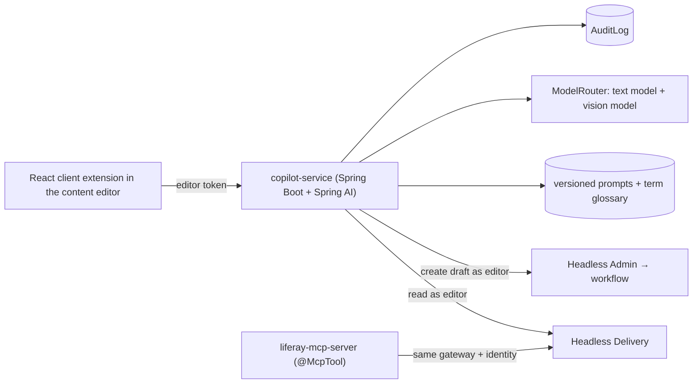

## Brief

Editors on a multi-site Liferay DXP portal spend hours on summaries, SEO descriptions, translations and image alt text. Build a copilot that proposes these as **drafts** inside Liferay's existing workflow, and expose the same capabilities to other AI hosts through a **Liferay MCP server**.

## Requirements

| Capability | Acceptance criteria |
|---|---|
| Summary + SEO description for a web content article | Judge score ≥ 4/5 on rubric (length, accuracy, keywords) for 30 articles; editor acceptance tracked |
| Translation (EN↔DE at least) with glossary of product terms | Terminology accuracy ≥ 95% on glossary terms |
| Alt text for images in Documents and Media (vision model) | ≤ 125 characters; reviewed before save |
| Drafts via Headless Admin API into workflow | No direct publishing path exists (tested) |
| MCP server: `search_content`, `get_content`, `propose_summary` | Contract tests with the Phase 11 client; read-only by default |
| Audit | Every suggestion logged with prompt version, model and editor decision |

## Suggested architecture

## Milestones

| # | Milestone | Exit criteria |
|---|---|---|
| 1 | Canvas + eval sets per capability | 30 articles, 50 glossary terms, 20 images |
| 2 | Service with fakes + mocked Liferay (MockRestServiceServer) | Drafts flow tested end to end |
| 3 | Real models + prompt versions + evals in CI | Capability thresholds met |
| 4 | Client extension UI + editor feedback | Accept/edit/reject captured |
| 5 | MCP server + security review | Contract tests; threat model; no publish path |
| 6 | Review | Evidence pack; editor time saved estimated with the business case model |

## Running Liferay locally

The official `liferay/portal` Docker image (Community Edition) is enough for development; create OAuth2 applications in Control Panel for the client extension and the services. Pin the image version you develop against.

## Stretch goals

- Per-site tone-of-voice configuration.
- Fine-tuned small model for SEO descriptions distilled from accepted drafts (Phase 13).
