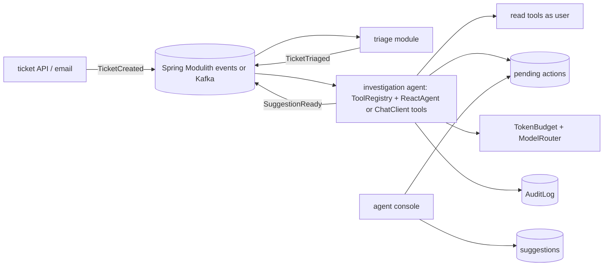

## Brief

Build the support copilot from Phase 16 lesson 5 at small scale: tickets arrive as events, a triage model classifies them, an investigation agent gathers facts with read-only tools, a draft reply is prepared with KB citations, and side-effecting actions become **pending actions** that agents approve.

## Requirements

| Capability | Acceptance criteria |
|---|---|
| Event-driven pipeline (`TicketCreated` → `TicketTriaged` → `SuggestionReady`) | Idempotent consumers; DLQ; replay works |
| Triage with structured output | Accuracy ≥ 90% on 200 labelled tickets |
| Investigation agent (ReAct or Spring AI tools) | Step limit, token budget, loop detection; ≤ 6 steps p95 |
| Read tools: ticket history, order status, KB search | Run as the agent user; permission tests pass |
| Write tools → pending actions (refund, licence reset) | Nothing executes without approval; thresholds enforced in code |
| Shadow mode report | Agreement with human decisions per action type |
| Safety evals | 30 injection/abuse cases, 100% contained |

## Suggested architecture

## Milestones

| # | Milestone | Exit criteria |
|---|---|---|
| 1 | Canvas, labelled tickets, safety cases | Datasets versioned |
| 2 | Event pipeline + fakes | Replay and idempotency tests pass |
| 3 | Triage + investigation agent | Accuracy and step-budget gates |
| 4 | Pending actions + console | No-execution-without-approval tests |
| 5 | Shadow mode over 100 historical tickets | Agreement report per action type |
| 6 | Hardening + review | Evidence pack; autonomy recommendation per action type with data |

## Stretch goals

- Distil triage into a fine-tuned small model and compare cost/quality (Phase 13).
- Expose ticket tools via an MCP server for an IDE or chat host (Phase 11).
- Monte Carlo forecast of remaining work updated each week (Phase 17).
